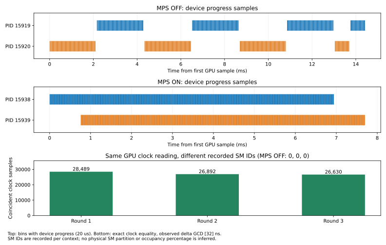
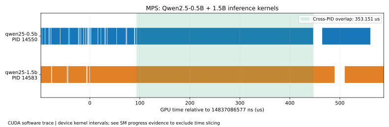
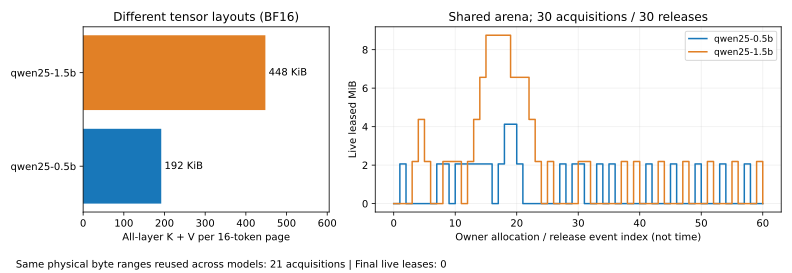

# MPS 并行执行与不同 KV tensor 大小的双模型验证

本报告对应 2026-10-12 的 RTX 5090 实测。结论是：两个独立进程在 MPS 下能同时推进 GPU 指令；Qwen2.5-0.5B-Instruct、Qwen2.5-1.5B-Instruct 能通过共享字节池使用各自不同大小的 KV page，并在完成释放后跨模型复用同一显存范围。

## 环境与证据层次

- Ubuntu 22.04.5 容器，原生 Linux 主机内核 6.12.101-compshare；RTX 5090，32 GB，驱动 610.57.04。
- CUDA 12.8 编译，`sm_120`；Nsight Systems 2025.6.3.343，来自 CUDA 13.2 工具目录。NCCL 构建关闭。
- 源码基于 `a8cc25549617b0376e844c19c73fdc8c8ff17454`，加 RE2 CMake 查找和旧版 nlohmann JSON 迭代兼容修复；新增的执行采样程序随本报告提供。源码哈希见 `artifact-manifest.json`。
- 权重、tokenizer 哈希见[模型清单](../rtx5090-mps-2026-10-12/model-hashes.json)，运行配置见[部署配置](../rtx5090-mps-2026-10-12/deployment-config.json)。均使用 BF16 KV，radix cache 关闭；每模型最多一个 active request，两个模型可同时执行。MPS active thread percentage 各 50%，这是限制配置，不是实测 SM 占用率，也不保证独占物理 SM。

| 证据 | 能说明什么 | 不能单独说明什么 |
| --- | --- | --- |
| MPS server/client PID 注册 | 两个 worker 确实连接同一 MPS server | 是否同时执行 kernel |
| Nsight CUDA device kernel 区间 | 真实模型 kernel、PID、设备和执行区间 | 仅区间重叠不能排除中途 context 切换 |
| kernel 内时钟与 SM 采样，MPS 开关对照 | 本机 32 ns 观测粒度下，两个进程同时执行设备指令 | SM 占用百分比、模型吞吐提升、固定物理 SM 分区 |
| owner 的 lease 区间审计 | 同一物理 arena 的字节归还后被另一模型复用，无存活区间冲突 | 不同模型共享相同语义的 KV 值 |
| 真实权重输出、取消和回收检查 | 所测请求的正确性保持与资源回收 | 所有模型、所有输入的全面正确性 |

## 1. 排除 kernel 生命周期重叠的假象

最初使用 `clock64` 忙等待的长 kernel。MPS 下 Nsight 记录两个 PID 的区间重叠 **250.601386 ms**。补跑关闭 MPS 的同一探针，仍得到 **249.766956 ms** 区间重叠：GPU 可以在 kernel 中途切换进程，时钟还会继续走。因此这两组数字只属于生命周期区间，不能作为真实同时推进计算的最终证据。关闭 MPS 的数据保留在 `process-interval-control.json`。

新增 `demo/mps_sm_activity_probe.cu`：每个进程启动 4 blocks × 32 threads，每个 block 固定循环 250,000 次；每次执行 16 次依赖 FMA，lane 0 记录 `%globaltimer`、`%smid` 和计算值。计算结果被写出并检查，避免算术被优化掉。两个进程各记录 1,000,000 条采样；预热、ready barrier 和 MPS 注册检查发生在正式采样前。三轮均使用相同二进制，按 MPS OFF → ON 顺序执行，采样不依赖 Nsight。

| 轮次 | MPS OFF：同 tick 且记录 SM 不同 | MPS ON：同 tick 且记录 SM 不同 |
| --- | ---: | ---: |
| 1 | 0 | 28,489 |
| 2 | 0 | 26,892 |
| 3 | 0 | 26,630 |

同 tick 指两个进程实际执行读取指令，得到**完全相同的 64 位 GPU 时钟值**，不是把两个 kernel 的 start/end 相交。所有运行的时间戳增量观测 GCD 均为 32 ns。第一轮的一个原始例子：

```text
globaltimer_ns       PID    recorded smid
1791741754962222304  15938  2
1791741754962222304  15939  0
```

每个进程在同一 tick 可能有多个 block 的采样；分析器只保留其中一个 SM，所以报告的是保守计数。SM 编号按 context 记录，不将两个进程的编号解释成全局固定物理分区。32 ns 是这台机器的观测粒度，不是 PTX 跨平台保证；结论限定在这个采样分辨率，不声称测得同一时钟周期内的精确指令发射或 occupancy 百分比。



上两行展示第一轮各进程在 20 μs 桶中是否有执行采样，横轴均从该次运行的第一个 GPU 采样开始；下图计数使用原始时钟值的精确相等比较，并非 20 μs 分桶。输入为 `sm-activity.json`、`sm-*.csv`。记录格式与各原始二进制文件哈希在 JSON 内。

## 2. 两个真实模型的 GPU kernel

`models-registry.json` 将 PID **14550** 对应至 0.5B，PID **14583** 对应至 1.5B；两者连接 MPS server **14512**。只提取这两个 worker 的 CUDA kernel，不把私有 KV 基线或 owner 的进程混入统计。

| 项目 | 结果 |
| --- | ---: |
| 0.5B / 1.5B kernel 记录数 | 97,975 / 42,195 |
| 跨进程重叠 kernel 对数 | 25,381 |
| 跨进程区间交集的并集长度 | 108.839570 ms |
| 所有 worker kernel 区间的并集长度 | 775.191499 ms |
| 最长重叠对 | 353.151 μs |

“对数”允许一个 kernel 与另一进程多个 kernel 相交；“并集长度”按事件扫描计算，多个 stream 的同一时间段不重复计费。统计覆盖整次验证，包括初始化、预热、并发及交替请求，不用它计算纯推理并发率或加速比。



放大窗口由脚本自动选择最长重叠对，并向两侧各扩展 20%。该对均为 cuBLAS BF16 GEMV：1.5B 的 grid 为 `[37984,1,1]`、block `[16,4,1]`；0.5B 的 grid 为 `[18992,1,1]`、block `[8,8,1]`。完整符号名、绝对 trace 纳秒时间戳及窗口内其他 kernel 在 `models-timeline.csv`。这是实际模型工作负载的记录；第 1 节的 FMA 采样是独立诊断程序，没有冒充模型 kernel 内部的 SM 采样。

默认 `--trace=cuda` 在本环境前两次采集失败；`--trace=cuda-sw,nvtx` 成功。NVIDIA 文档说明 MPS 应使用软件 CUDA trace，参见 [Nsight Systems User Guide](https://docs.nvidia.com/nsight-systems/UserGuide/index.html)。PTX 寄存器含义和平台限制见 [PTX ISA](https://docs.nvidia.com/cuda/parallel-thread-execution/index.html)。

## 3. 不同 tensor 大小如何复用显存

每个逻辑 page 为 16 tokens，BF16 每元素 2 bytes，KV heads 均为 2。0.5B：24 层、head dimension 64；1.5B：28 层、head dimension 128。

```text
0.5B 单层 K 或 V = 16 × 2 × 64  × 2 = 4,096 bytes
1.5B 单层 K 或 V = 16 × 2 × 128 × 2 = 8,192 bytes
0.5B 全层 K+V page = 24 × 2 × 4,096 = 196,608 bytes (192 KiB)
1.5B 全层 K+V page = 28 × 2 × 8,192 = 458,752 bytes (448 KiB)
```

共享 owner 持有一个 512 MiB `cudaMalloc` allocation；两个 worker 通过 CUDA IPC 映射它，分别维护自己的 page table 和模型布局。Chunk 以全层 page 为对齐单位，2 MiB 目标向上取整得到 0.5B 的 2,162,688 bytes / 11 pages，1.5B 的 2,293,760 bytes / 5 pages。各自的 KV 值、权重、激活均有独立语义。

`kv-events.csv` 的前三条直接展示物理区间转移：

| owner 事件序号 | 动作 | 模型 / layout | lease | offset | bytes |
| ---: | --- | --- | ---: | ---: | ---: |
| 1 | acquire | 0.5B / `page-major-gqa-v1:24:4096` | 1 | 0 | 2,162,688 |
| 2 | release | 0.5B / `page-major-gqa-v1:24:4096` | 1 | 0 | 2,162,688 |
| 3 | acquire | 1.5B / `page-major-gqa-v1:28:8192` | 2 | 0 | 2,293,760 |

三条记录属于同一 owner epoch，实际地址以各 worker 的 IPC 映射基址加 offset 解析，不要求虚拟指针值相同。释放后重新分配及写入，不把 0.5B 的 KV 数值当作 1.5B 的 KV 使用。



整次记录有 30 acquire / 30 release，21 次 acquire 与另一模型历史已释放的范围相交；任何同时存活的 lease 都无物理范围冲突；最终存活 lease 为 0。图中横轴是 owner 事件顺序，不伪装成 GPU 时间。10 次交替真实推理后均恢复 536,870,912 free bytes / 0 leases；输出与各自私有 KV 基线一致，流式 UTF-8、取消路由、取消记录回收、非法 RPC 和未知模型拒绝均通过，见 `models-validation.json`。这不是与 Transformers 的全模型数值一致性验收。

本次真实模型请求的峰值租用为 13,500,416 bytes，并未把 512 MiB 池用满。因此它证明异构布局的实际使用和释放复用，不声称证明满池性能；满池、pin 和 fence 约束可另运行既有 `validate_kv_reuse.py`。

## 复现

先按[部署指南](../../cuda-mps-v4-integration-2026-10-11.md)完成模型导出与编译。以下从仓库根目录运行；配置内的权重路径需要对应实际部署机器。不要复用已存在的运行目录。

```bash
cmake --build build-mps --target mps_sm_activity_probe -j 8
python3 -m pip install numpy matplotlib pyzmq

export EVIDENCE_DIR="$PWD/mps-evidence-run"
mkdir -p "$EVIDENCE_DIR"
export NSYS=/usr/local/cuda-13.2/bin/nsys
export PBE_CONFIG="$PWD/docs/benchmarks/rtx5090-mps-2026-10-12/deployment-config.json"

# 三轮 MPS 开关对照；脚本管理自己的 daemon，最后停止所有客户端。
python3 tools/serving/validate_mps_sm_activity.py \
  --binary build-mps/demo/mps_sm_activity_probe \
  --output-dir "$EVIDENCE_DIR/sm-activity" --rounds 3

# 合成探针的 Nsight 记录。
"$NSYS" profile --trace=cuda-sw,nvtx --sample=none --cpuctxsw=none \
  -o "$EVIDENCE_DIR/probe-timeline" \
  python3 tools/serving/deploy_multi_model.py --build-dir build-mps \
  --backend mps_process --start-mps --probe --runtime-dir "$EVIDENCE_DIR/probe"

# 真实双模型；CUDA graph 按 node 采集，保留 owner 分配 / 释放事件。
PBE_SHARED_KV_TRACE=1 OPENBLAS_NUM_THREADS=1 OMP_NUM_THREADS=1 \
"$NSYS" profile --trace=cuda-sw,nvtx --cuda-graph-trace=node \
  --sample=none --cpuctxsw=none -o "$EVIDENCE_DIR/models-timeline" \
  python3 tools/serving/validate_multi_model.py --config "$PBE_CONFIG" \
  --build-dir build-mps --backend mps_process --start-mps \
  --reuse-rounds 5 --output-dir "$EVIDENCE_DIR/models"

"$NSYS" export --type sqlite -o "$EVIDENCE_DIR/probe-timeline.sqlite" \
  "$EVIDENCE_DIR/probe-timeline.nsys-rep"
"$NSYS" export --type sqlite -o "$EVIDENCE_DIR/models-timeline.sqlite" \
  "$EVIDENCE_DIR/models-timeline.nsys-rep"

mkdir -p "$EVIDENCE_DIR/published"
cp "$EVIDENCE_DIR/sm-activity/summary.json" "$EVIDENCE_DIR/published/sm-activity.json"
for backend in process mps_process; do
  for round in 0 1 2; do
    cp "$EVIDENCE_DIR/sm-activity/$backend-$round/activity-bins.csv" \
      "$EVIDENCE_DIR/published/sm-$backend-$round.csv"
  done
done
python3 tools/serving/summarize_mps_evidence.py \
  --probe-sqlite "$EVIDENCE_DIR/probe-timeline.sqlite" \
  --probe-report "$EVIDENCE_DIR/probe/probe.json" \
  --models-sqlite "$EVIDENCE_DIR/models-timeline.sqlite" \
  --registry "$EVIDENCE_DIR/models/domain/registry.json" \
  --owner-trace "$EVIDENCE_DIR/models/domain/kv-owner.log" \
  --sm-activity-report "$EVIDENCE_DIR/published/sm-activity.json" \
  --output-dir "$EVIDENCE_DIR/published"

python3 -m unittest discover -s tools/serving -p test_mps_evidence.py -v
```

如需复现“生命周期重叠不能单独证明并行”的反例，再运行合成探针的 profile 命令，使用 `--backend process`、移除 `--start-mps`，并另选输出路径。不要将合成 FMA 的运行时间比直接宣传为模型推理加速比。

### 常驻双模型演示

验收脚本完成后会停止服务。需要现场展示时，在一个终端启动下列命令；配置和模型路径沿用上文。等日志显示 HTTP 服务就绪，再在另一个终端发送两个请求。

```bash
python3 tools/serving/deploy_multi_model.py --config "$PBE_CONFIG" \
  --build-dir build-mps --backend mps_process --start-mps \
  --runtime-dir /tmp/pbe-live-demo
```

```bash
curl -s http://127.0.0.1:8080/v1/completions \
  -H 'Content-Type: application/json' \
  -d '{"model":"qwen25-0.5b","prompt":"请用一句话介绍中国的首都。","max_tokens":64,"temperature":0}' \
  > /tmp/pbe-05b-output.json &
curl -s http://127.0.0.1:8080/v1/completions \
  -H 'Content-Type: application/json' \
  -d '{"model":"qwen25-1.5b","prompt":"请用一句话介绍中国的首都。","max_tokens":64,"temperature":0}' \
  > /tmp/pbe-15b-output.json &
wait
cat /tmp/pbe-05b-output.json /tmp/pbe-15b-output.json
```

在服务终端按 Ctrl-C 触发有序回收。再次启动时选新的 runtime 目录。HTTP 输出用于展示两个模型和路由；判断 GPU 并行仍使用前述设备采样和 profiler 证据。

## 发布和审计

SVG 均由脚本根据采样或事件数据绘制。Git 内保留小型 JSON / CSV / SVG、分析程序和复现步骤；完整 `.nsys-rep`、SQLite、日志及设备采样二进制按[证据发布规则](../../EVIDENCE_PUBLICATION.md)留在原实验工作区。远端目录为 `/workspace/pbe-validation/`；本地归档位置及文件 SHA-256 见 `artifact-manifest.json`。哈希提供完整性校验，不代替重新运行验证。可用 Nsight Systems GUI 打开原始 report，按 registry 中的 PID 查看两个 CUDA context。

所有本轮测试进程和自建 MPS daemon 均在验证后停止。现有 `probe.json` 中的 `mps_kernel_overlap_verified=false` 保持原样：它是原探针自身的结论，该探针没有读取 profiler 数据。新增的 `sm-activity.json` 和 `summary.json` 单独记录补充证据，不篡改旧探针的字段。
