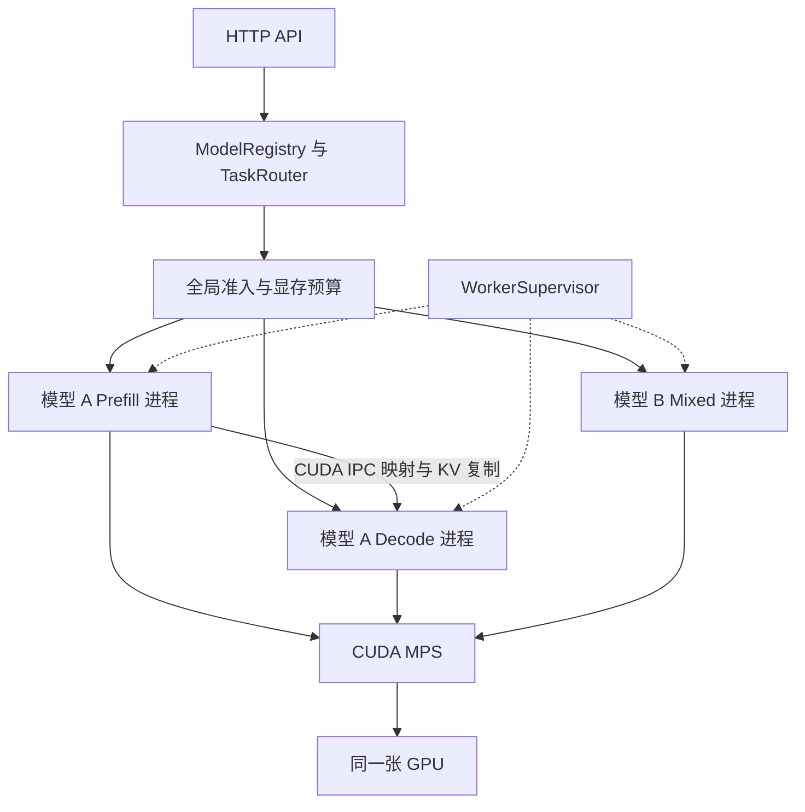

# PagedBatchEngine CUDA MPS 与多模型部署升级方案

建议采用 **统一入口与资源管理器、每模型独立 worker、CUDA MPS 并发执行、CUDA IPC 完成同卡 KV 交接** 的架构。先实现多个小模型同时驻留并处理各自的任务，再为需要保护 decode 延迟的模型启用独立 prefill 和 decode 进程。保留当前混合执行模式，通过基准决定每个模型是否适合拆分。

设计日期：2026 年 10 月 11 日。代码基线：工作区当前实现，Git HEAD 为 `f3597a7`，包含本地未提交内容。本文是升级设计，新增模块、配置和接口均为拟实现项。

首个完整版本的交付目标是：一张 GPU 常驻两个不同权重的小模型；请求按模型和任务路由；至少一个模型可切换为同卡 P/D 进程部署；能够观测到不同请求的 prefill 与 decode kernel 重叠，并且正确处理容量不足、取消和 worker 重启。

## 当前实现与改造起点

现有代码已经有相当多可复用能力，不需要重新开发推理主干。下面按当前源码描述状态，旧设计文档中的阶段判断不作为已实现能力的依据。

| 模块与入口 | 当前实现 | 升级内容 |
| --- | --- | --- |
| [serving_qwen.cpp](../demo/serving_qwen.cpp) | 主服务绑定 `Qwen2Model`；本地双卡 P/D 加载两个实例，远程角色分别加载一个实例 | 抽出模型实例描述和 worker 启动配置，支持不同权重、tokenizer、任务 |
| [serving_config.h](../infMain/include/serving/serving_config.h) | 有 `off`、双 GPU、远程 ZMQ CPU/NCCL 模式 | 增加同卡 IPC 模式，分离部署拓扑和传输后端 |
| [serving_online_engine_pool.h](../infMain/include/serving/serving_online_engine_pool.h) | `SingleOnlineEnginePool` 和连接单一 endpoint 的 `ZmqOnlineEnginePool` | 新增按模型路由的 `MultiModelEnginePool` |
| [serving_online_engine.h](../infMain/include/serving/serving_online_engine.h) | `OnlineGenerateRequest` 包含 prompt、采样配置、stream、timeout，没有模型标识 | 增加模型、任务和全局请求身份 |
| [serving_online_server.cpp](../infMain/source/serving/serving_online_server.cpp) | ChatML 模板在 HTTP 层拼接，响应模型名固定 | 根据路由选择模板，回传实际模型名，增加模型列表 |
| [serving_zmq_engine_core.cpp](../infMain/source/serving/serving_zmq_engine_core.cpp) | 已有 prefill worker、异步 submit/poll 和 KV release 消息 | 扩展注册、epoch、IPC pool 握手、取消与配额协议 |
| [serving_online_engine.cpp](../infMain/source/serving/serving_online_engine.cpp) | 远程 NCCL 批处理循环已有 prefill、transfer、decode 三阶段；prefill 完成后才申请 D 端 reservation | 将后端从 NCCL 解耦，前移容量接纳，移出 decode 热路径上的同步 RPC |
| [pd_handoff.h](../infMain/include/serving/pd_handoff.h) 与 [decode_kv_reservation.h](../infMain/include/serving/decode_kv_reservation.h) | 已有 manifest、源目标 block 映射、connector 和 reservation | 扩展模型兼容身份和 epoch；新增 IPC connector |
| [serving_memory_planner.cpp](../infMain/source/model/serving_memory_planner.cpp) | KV 容量依据当前设备空闲字节乘利用率推算，默认利用率为 0.8 | 多 worker 模式改为全局分配的绝对字节预算 |
| [block_allocator.cpp](../infMain/source/base/block_allocator.cpp) | 每层有独立 K/V pool，FP8 另有 scale pool | 首版保留布局，增加可导出 allocation 描述和外部引用生命周期 |
| [cuda_backend_runtime.cpp](../infMain/source/base/cuda_backend_runtime.cpp) | `compute_queue` 和 `transfer_queue` 当前指向同一 stream | IPC 路径创建独立 non-blocking copy stream 和跨 stream 依赖 |

需要优先解决的三个问题：**多进程显存超配、跨进程 KV 所有权、请求缺少模型身份**。只启动 MPS daemon 无法补齐这些能力。

## 部署环境与 MPS 边界

本次只读检查显示，当前开发环境为 WSL2，内核 `6.6.87.2-microsoft-standard-WSL2`，GPU 为 RTX 4060 Laptop，显存 8188 MiB，驱动 566.26；`nvidia-cuda-mps-control` 未出现在 PATH 中。这些信息不能证明目标部署环境已支持 MPS。

实施时将原生 Linux 作为 MPS 验证环境。当前 WSL 工作区可继续做路由、协议、显存规划和普通推理验证；MPS 与 IPC 能力必须在目标机分别探测。WSL 的部分 CUDA 与管理功能存在限制，不能从 CUDA 推理可运行推导出 MPS 可运行。参见 [CUDA on WSL User Guide](https://docs.nvidia.com/cuda/wsl-user-guide/index.html)。

本方案首版选用目标驱动支持的传统 MPS 动态资源配置方式，不依赖新版本静态 SM 分区或 MPS v3。部署工具记录驱动、CUDA runtime、MPS 版本和实际设备能力，按版本选择命令；不混用不同版本的管理接口。

MPS 允许不同进程提交的 kernel 并发，适合单个任务没有占满 GPU 的情况。它不保证吞吐提升；同卡 P/D 仍共享显存带宽、缓存和其他资源。`CUDA_MPS_ACTIVE_THREAD_PERCENTAGE` 是执行资源上限，不是独占 SM 配额或时间份额，不能据此承诺延迟隔离。参见 [MPS 使用条件](https://docs.nvidia.com/deploy/mps/when-to-use-mps.html) 和 [环境变量](https://docs.nvidia.com/deploy/mps/appendix-environment-variables.html)。

由此确定以下设计边界：

- MPS 负责跨进程 GPU 执行；模型路由、公平调度、显存预算和服务恢复由框架负责。
- 权重、KV 和工作区默认属于各 worker。两个进程加载同一权重仍按两份 GPU 权重预算。
- 同一请求必须先完成 prefill 再 decode。期望重叠的是“请求 A 的 prefill”和“请求 B 的 decode”。
- 对话、摘要、翻译、代码生成可先统一为文本生成任务。embedding、rerank、分类专用输出头需要额外模型后端与 API，不能仅改路由名称就宣称支持。

## 目标架构与部署拓扑



控制面通过现有 ZMQ 传请求、状态、资源租约和 IPC handle；KV 数据在 GPU 内复制。API/router 进程不初始化 CUDA，worker 使用独立程序启动，在 CUDA 初始化前设置设备可见性和 MPS 环境变量。

每个 worker 拥有自己的模型实例、tokenizer、scheduler、KV manager、CUDA context、streams、cuBLAS handles、workspace 和 CUDA Graph。异构权重模型的请求不能直接放入当前同一个 forward batch。

| 拓扑 | GPU worker 数 | 适用阶段 | 主要成本 |
| --- | ---: | --- | --- |
| 两个模型，各一个 mixed worker | 2 | 多模型首版，显存紧张或负载较低 | 每模型一份权重和 KV pool |
| 模型 A 拆 P/D，模型 B 保持 mixed | 3 | 推荐的首个完整版本 | A 的权重和部分 KV 暂时重复 |
| 每个模型都拆 P/D | 2 × 模型数 | 只有实测收益和容量支持时启用 | 权重、context、workspace 和通信成本增长 |
| 共享权重或共享 KV Arena | 取决于部署 | 后续优化 | 跨进程所有权与故障恢复显著复杂化 |

对于当前约 8GB 显存级别，先使用现有 Qwen2 0.5B 级别模型验证两模型 mixed，再验证一个模型的 P/D。两个任务别名指向同一份模型只能验证任务路由；多模型验收应至少使用两份不同权重。

## 同卡 Prefill Decode 进程方案

### 传输后端选择

新增兼容入口 `--pd-mode=same-gpu-ipc`。内部逐步规范为 `execution_mode=mixed|pd` 与 `kv_transfer_backend=none|cuda-ipc-copy|p2p|nccl|cpu`，由配置校验器约束组合。

同卡跨进程使用 `CudaIpcKVTransferConnector`：D 进程映射 P 的 pool，把所需 KV 复制到 D 自己的 pool。这样可以复用当前 D 端 block table 和 attention kernel，也能在交接完成后释放 P 的请求引用。

现有本地 NCCL connector 显式要求两个不同设备，不能简单把两个 device ID 都改成 0。较新 NCCL 自 2.30 起提供实验性的同 GPU 多 rank 开关，附带资源和配置约束；本方案不依赖该能力，NCCL 继续服务跨 GPU 场景。参见 [NCCL 多 rank 配置说明](https://docs.nvidia.com/deeplearning/nccl/user-guide/docs/env.html#nccl-multi-rank-gpu-enable)。

`remote-zmq-cpu` 可用于低负载协议对照，但 host staging 和序列化成本不适合作为目标同卡数据通路。现有 P2P connector 持有本进程的 manager 和指针，同样不能直接用于独立进程。

### IPC 内存与事件协议

新增 `IpcPoolRegistry`，在 pool 初始化时导出各层 K、V 及可选 scale allocation，在重启或 pool 重建时更新 `pool_epoch`。每个请求只传 block 映射和事件引用，不反复导出和打开整池。

CUDA IPC 通过可传递 handle 在接收进程获得本地有效指针，不能传递原始设备地址。首版采用专用 `cudaMalloc` allocation，使用 allocation 基址和经过边界检查的偏移；不把 `cudaMallocManaged` 或任意 allocator 子块直接当作可导出的独立对象。参见 [CUDA IPC 编程指南](https://docs.nvidia.com/cuda/archive/13.2.0/cuda-programming-guide/04-special-topics/inter-process-communication.html)。

```text
PoolRegistration
  protocol_version, model_id, model_revision, cache_compatibility_id
  worker_id, worker_epoch, pool_id, pool_epoch, gpu_uuid
  layout_id, layer_count, block_size, kv_heads, head_dim, dtype, storage_mode
  allocations[]: allocation_id, ipc_mem_handle, allocation_bytes
  components[]: layer_id, K|V|K_scale|V_scale, allocation_id, offset, stride

HandoffDescriptor
  global_request_id, handoff_id, attempt_id
  model_id, model_revision, cache_compatibility_id
  src_worker_epoch, dst_worker_epoch, src_pool_epoch, dst_pool_epoch
  reservation_id, computed_tokens, first_token, sampling_state
  layer_mappings[], ready_event_id, event_generation
```

P/D 必须具有同一有效权重、适配器、位置编码、KV 格式和相关执行配置。`cache_compatibility_id` 要覆盖这些身份；仅比较层数、head 数、dtype 或显示名称不够。首版要求 P/D 完全相同布局，不在传输时做 dtype 转换。

### 请求交接状态机

```text
QUEUED → D_RESERVED → P_RUNNING → P_READY → COPYING → D_READY → DECODING → FINISHED
                          任意未结束阶段 → CANCEL_PENDING 或 FAILED → 安全回收
```

1. **D 先接纳容量。** 根据真实 tokenizer 得到的 prompt 长度与输出上限预留 D 端容量，再向 P 提交。初版为 prompt 与最大输出所需 block 预留容量信用，可先分配 prompt block，再按信用扩展。当前 reservation 依赖 P 端 manifest，应拆成早期 `reserve_capacity` 和后续 `bind_manifest` 两步。
2. **P 执行和采样。** 保留 chunked prefill。完成 prompt 后由 P 产生首 token；记录 prompt KV 的 `computed_tokens`，并持有 source blocks。首 token 是随后 D 的输入，它自身的 KV 尚未因采样而写入。
3. **发布就绪事件。** P 在写 KV 的 compute stream 上记录 IPC event，再发送 manifest。event 使用 `cudaEventInterprocess | cudaEventDisableTiming`；在消费者确认前不得把同一事件槽用于下一次 handoff。
4. **D 等待并复制。** D 的 copy stream 等待 P event，按每层 block 映射复制 K/V；FP8 扩展时还复制 scale。连续 block 可合并复制，非连续映射保持显式。
5. **提交给 decode。** D 记录 copy-complete event，compute stream 等待该事件后才能运行此请求。其他已就绪请求继续 decode，CPU 控制循环不等待整次传输完成。
6. **确认并释放。** 确认复制完成后发送幂等 `HandoffCopied`，P 释放本请求的 source 引用；存在本地 prefix cache 引用时不能回收实际 block。D 继续生成并负责输出去重。

IPC event 与映射的销毁必须晚于最后一次使用；接收方使用 `cudaIpcCloseMemHandle` 关闭映射，不对导入地址调用 `cudaFree`。导出方释放 allocation 前要等待所有导入方关闭。参见 [CUDA IPC 事件和内存生命周期 API](https://docs.nvidia.com/cuda/cuda-driver-api/cuda_driver_api/group__CUDA__MEM.html)。

首版建议在 D_READY 后对外发送首 token，简化交接失败语义。后续可以提前发送，但必须同时评估首 token 到第二 token 的间隔，避免 TTFT 变好而用户看到长时间停顿。`max_new_tokens=1`、首 token 为 EOS、空输出上限均需专门处理。随机采样模式还要传递每请求 RNG 状态或采用按请求与 token 位置确定的随机计数器。

### 取消与故障处理

所有状态变更校验 `request_id + attempt_id + worker_epoch + pool_epoch`，重复 ACK、重复 cancel 和迟到消息返回已处理结果。超时只触发取消流程，不能证明 GPU 已停止访问内存。

- 取消发生在复制中：标记请求不再输出，等待 copy fence，再释放 D reservation 和 P 引用。
- P 正常退出：停止接纳，排空计算与交接，通知 D 关闭映射，再销毁导出池。
- P 意外退出：使其 pool epoch 失效，停止相关 IPC 操作；本轮未完成 handoff 请求失败。不能假设捕获一个 CUDA 错误后即可继续使用旧映射。
- D 重启：丢弃旧请求和旧 reservation，注册新 epoch 后重新开放路由。已输出 token 的请求首版不做透明重试。
- MPS/GPU 发生致命错误：Supervisor 按实际受影响的 GPU 域恢复，不能承诺故障只影响一个 worker。停止活动 MPS client 应遵循排空或受支持的 client termination 流程。参见 [MPS 终止与故障条件](https://docs.nvidia.com/deploy/mps/when-to-use-mps.html#client-early-termination)。

### 消除 CPU 侧串行瓶颈

`run_remote_pd_batch_loop()` 当前在 decode 调度循环里执行同步 prefill submit/poll RPC；MPS 无法消除这类阻塞。新增控制面线程与 completion queue，让计算线程每轮只消费已到达结果。限制每轮处理消息数、在途 handoff 数和复制字节数，避免大量新请求挤占 decode 时间。

`ZmqOnlineEnginePool` 当前每请求创建 polling thread。多模型版本改为每 worker 一个受控事件循环或有界 polling pool，避免模型数乘并发数造成线程增长。ZMQ socket 的创建与使用遵循其线程归属要求，不能把单个 socket 任意跨线程复用。

## 多模型路由与任务执行

新增三个核心组件：

| 组件 | 职责 |
| --- | --- |
| `ModelRegistry` | 注册模型 ID、权重版本、tokenizer、chat template、后端、支持任务、上下文上限和部署拓扑 |
| `TaskRouter` | 将请求的 `model` 或显式 task policy 映射到模型；校验冲突和不支持的任务 |
| `MultiModelEnginePool` | 管理多个模型的 worker endpoint、ready 状态和请求生命周期；P/D 以一组服务容量呈现 |

API 示例为拟支持协议：

```json
{
  "model": "summary-small",
  "task": "summarization",
  "messages": [{"role": "user", "content": "请总结这段文字……"}],
  "max_tokens": 128,
  "stream": true
}
```

`model` 明确指定时优先校验该模型支持的任务；仅指定 task 时使用注册表中的默认映射。只有一个默认模型时可兼容省略 `model` 的旧请求；存在多个模型且没有默认值时返回明确错误。增加 `/v1/models`，响应和 SSE chunk 使用实际模型 ID。

chat template 和 tokenizer 应随模型选择。入口保留结构化 messages，由相应模型适配器构造 prompt；不要先用固定 Qwen ChatML 格式化所有模型。tokenization 完成后再做上下文长度与 KV 接纳检查。

同一模型允许对话、摘要等任务共用权重实例，任务策略控制 system prompt、采样参数、长度上限和优先级。不同权重模型拥有独立 batch 和 prefix cache。缓存键至少包含有效模型版本、适配器、模板/tokenizer 相关版本与 token 前缀，禁止仅按 token IDs 跨模型命中。

会话、取消、流式事件和指标都必须带 `model_id` 与全局请求 ID。初版不在活跃请求之间切换模型或迁移 KV；模型更新通过启动新版本、切换新请求、排空旧版本完成。

## 显存预算与容量规划

### 从整卡剩余比例改为绝对预算

当前每个模型按 `free_bytes × utilization` 创建 KV pool。多个进程并行初始化时可能读取相近的 free 值并超配；串行初始化也会形成先启动者占据大部分显存的情况。多 worker 模式应要求显式 `worker_memory_budget_bytes`、`kv_pool_bytes` 和 workspace 上限。

对独立 pool 部署，使用以下约束：

```text
每个 worker j 的预算 Bj >= Wj + Kj + Aj + Gj + Cj + Tj
Σ Bj + GPU 全局预留 R <= GPU 可部署显存 M

W = GPU 权重与量化元数据
K = KV pool，包含 scale、对齐与页尾浪费
A = 激活、logits、cuBLAS workspace 与其他算子临时空间
G = CUDA Graph 相关常驻分配
C = context、runtime、allocator 缓存与碎片余量
T = staging、通信和模型加载峰值所需的额外空间
```

Supervisor 先预留预算，再按受控顺序启动 worker；每个 worker 测量加载与最大 batch warmup 峰值，超预算即不进入 READY。不能在预算不足时继续强行分配“最小 KV blocks”；此路径应返回可解释的容量不足错误。

MPS 的 `CUDA_MPS_PINNED_DEVICE_MEM_LIMIT` 可作为进程 GPU 内存分配的外层上限；它不是 host pinned-memory 参数，也不替代框架预算。具体 accounting 应在目标驱动上用独立分配与 IPC 导入实验验证。参见 [MPS 内存上限说明](https://docs.nvidia.com/deploy/mps/appendix-environment-variables.html#cuda-mps-pinned-device-mem-limit)。

第一版不做活跃 KV pool 的在线扩缩容。当前 [alloc_cu.cpp](../infMain/source/base/alloc_cu.cpp) 会缓存释放的 allocation，因此逻辑 block 释放、tensor 释放、物理显存归还不是同一个动作。首版通过排空并重启 worker 重新分配固定配额；后续增加可观测的 allocator trim 和可增长的分段 pool。

### 结合现有小模型估算 KV

对普通 GQA 模型，未计量化 scale、padding 与元数据时：

```text
每 token 的 KV 字节 = 2 × 层数 L × KV heads Hkv × head_dim D × 元素字节 s
每请求 KV 字节 ≈ ceil(保留 token 数 / block_size) × block_size × 每 token KV 字节
```

仓库 [Qwen2 0.5B 配置](../Qwen2ModelFile/Qwen2Model/Qwen2-0.5B-Instruct/config.json) 为 24 层、2 个 KV heads、hidden size 896、14 个 attention heads，因此 head dimension 为 64。假设 BF16 KV：

```text
2 × 24 × 2 × 64 × 2 = 12288 bytes/token = 12 KiB/token
4096 tokens 的 KV = 48 MiB/请求
32 个这样的请求 = 1536 MiB
```

这个估算只覆盖 KV，不包含权重、激活、graph、allocator 缓存或输出增长；FP8 scale 开销要沿用现有 `kv_cache_bytes_per_block_per_layer()` 公式。输出上限应计入接纳预算。

下面是一个约 8GB GPU 的**规划上限示例**，用于演示三进程预算校验，不是当前机器实测可用配置：

| 项目 | 上限 MiB |
| --- | ---: |
| 模型 A Prefill worker | 1792 |
| 模型 A Decode worker | 2816 |
| 模型 B Mixed worker | 2304 |
| GPU 全局预留 | 1024 |
| 总计 | 7936 |

每个 worker 上限必须容纳该进程完整开销。当前机器还有显示与其他程序占用，若可部署显存小于示例总额，或任一 worker 最大形状 warmup 超预算，就缩短上下文、降低 batch、改用更小模型，或回到两个 mixed worker。不能用权重文件大小直接代替 GPU 加载峰值。

## 两级调度与服务质量

上层 `GlobalAdmissionController` 决定请求何时进入哪个模型；下层沿用模型内部 scheduler 做 continuous batching、chunked prefill 和 decode。上层不对每次 kernel launch 加全局互斥锁，否则会把期望的并发重新串行化。

跨模型接纳使用有权重的轮转或 deficit scheduling，计费优先依据实测 GPU 时间估计，同时设置最低服务份额、队列上限和请求 deadline。不同模型的 token 成本不同，不把“相同 token budget”当作相同资源份额。

对拆分模型：D 端可用容量和在途 handoff 上限共同控制 P 的放行速度。Prefill 保留 chunk 上限，长 prompt 拆成小段；decode ITL 超标时，先降低 prefill chunk、prefill 并发和新请求速率。IPC 复制也消耗带宽，应限制每轮 copy burst。

第一轮实验可比较 P/D 的 `100/100`、`40/60`、`30/70` 线程百分比上限；多模型场景按所有活跃进程重新扫参。两项百分比相加为 100 只是实验配置，不能解释为严格切分 GPU。为避免依赖 context 级复杂行为，首版在排空并重启 worker 时变更 MPS 上限；传统 server 控制命令不会把新的线程上限追溯应用到现有 client。参见 [MPS v2 管理接口](https://docs.nvidia.com/deploy/mps/mpsv2-interface.html)。

CUDA Graph 保持进程内使用，IPC 注册和控制通信放在 capture 之外。pool 地址、模型版本或执行资源配置变化后重新 warmup/capture；IPC copy completion 依赖在 graph replay 前建立。cuBLAS 调优结果也应按 worker 的实际配置验证。

## 与共享 KV Pool Chunk 设计的衔接

仓库已有的[多模型共享 KV Pool 的 Chunk 架构设计 V1](<../多模型共享 KV Pool 的 Chunk 架构设计 V1.md>)明确以单 GPU、单进程、多个模型交替 forward 为首版。它解决的是物理 KV 空间复用；本方案先解决多进程并发与在线部署。两者可以演进到同一架构，但不能把原方案里的对象直接复制到多个进程并各自修改同一 free list。

建议分三级推进：

| 级别 | KV 管理方式 | 前置条件 |
| --- | --- | --- |
| K0 首版 | 每 worker 独立固定 pool，统一显存预算 | 多模型路由、预算和 IPC copy 正确 |
| K1 后续 | 同模型 P/D 共享 pool，D 分配目标位置，P 直接写入 | 唯一分配权、request lease、跨进程事件、prefix 引用与 COW |
| K2 后续 | 全 GPU 字节 Arena，按模型与布局租赁 chunk | 独立 memory owner、模型局部 page allocator、kernel 地址适配与故障恢复 |

K1 可减少 KV copy 和 prompt KV 的短暂双份驻留，但 P 要能向 D 所有的 pool 写入。最后一个未填满 page 在 D 继续写入前必须处理共享前缀的 copy-on-write，P 的本地 prefix cache 也不能保留已转移所有权的可写引用。

K2 将原设计的 `GpuArena` 与 `GlobalChunkAllocator` 放在长生命周期 memory owner 进程。worker 通过 IPC 映射 allocation，通过控制协议申请和归还 chunk；owner 是租约元数据的唯一写入方。权重与 workspace 仍单独预算，Arena 的物理字节只在全局计一次，不能给每个导入 worker 再重复计入物理容量。

chunk/page 使用 `(arena_epoch, chunk_generation, page_generation)` 防止旧句柄复用。回收必须同时满足引用归零、租约释放和最后一次 GPU 访问完成；租约超时不是 GPU fence。owner 崩溃时按 GPU 域停止访问并重建，不尝试沿用旧 handle。

当前 attention 路径使用每层 pool 与 block table，而原 Chunk 设计允许新的 page/组件布局。因此 K2 需要修改 `BlockAllocator`、`PagedKVRuntime`、batch metadata 和 attention/scatter 地址计算，逐个后端验证，不能仅替换 allocator。不同模型共享的是已释放的物理容量，KV 内容仍按模型身份隔离。

共享权重是独立后续项目：同模型 P/D 可探索只读权重 IPC owner，需保证 tensor 不写入、不搬迁、不重复释放。不同权重模型不会因为共享 Arena 而节省权重显存。

## 配置与启动设计

以下 YAML 是待实现的配置契约，当前 `serving_qwen` 尚不能直接读取。首版模型适配器先覆盖已有 Qwen2/Qwen2.5 生成路径。

```yaml
deployment:
  gpu_uuid: GPU-REPLACE-WITH-TARGET-UUID
  mps_mode: legacy_dynamic
  reserve_mib: 1024
  api_port: 8080

models:
  - id: chat-small
    revision: chat-v1
    backend: qwen2
    weights: /models/chat/model.bf16.bin
    tokenizer: /models/chat/tokenizer.json
    chat_template: qwen_chatml
    tasks: [chat]
    execution_mode: pd
    kv_transfer_backend: cuda-ipc-copy
    max_context_tokens: 4096
    workers:
      prefill:
        endpoint: ipc:///tmp/pbe-chat-prefill.sock
        memory_budget_mib: 1792
        kv_pool_mib: 256
        max_batched_tokens: 256
        prefill_chunk_cap: 128
        mps_active_thread_percentage: 30
      decode:
        endpoint: ipc:///tmp/pbe-chat-decode.sock
        memory_budget_mib: 2816
        kv_pool_mib: 1024
        max_num_seqs: 16
        mps_active_thread_percentage: 50

  - id: summary-small
    revision: summary-v1
    backend: qwen2
    weights: /models/summary/model.bf16.bin
    tokenizer: /models/summary/tokenizer.json
    chat_template: qwen_chatml
    tasks: [summarization, translation]
    execution_mode: mixed
    kv_transfer_backend: none
    workers:
      mixed:
        endpoint: ipc:///tmp/pbe-summary.sock
        memory_budget_mib: 2304
        kv_pool_mib: 512
        max_batched_tokens: 256
        max_num_seqs: 8
        mps_active_thread_percentage: 30
```

参数均为启动实验值。配置校验需计算 KV、权重和 workspace 预算，检查 endpoint 唯一、P/D 兼容身份与 GPU UUID 一致。MPS 比例允许总和超过 100，因为这里配置的是上限；应通过实际负载决定是否合适。

传统 MPS 的原生 Linux 启动示例只负责 GPU 服务，不表示框架改造已完成：

```bash
export CUDA_VISIBLE_DEVICES=GPU-REPLACE-WITH-TARGET-UUID
export CUDA_MPS_PIPE_DIRECTORY=/tmp/pbe-mps-pipe
export CUDA_MPS_LOG_DIRECTORY=/tmp/pbe-mps-log
mkdir -p "$CUDA_MPS_PIPE_DIRECTORY" "$CUDA_MPS_LOG_DIRECTORY"
chmod 700 "$CUDA_MPS_PIPE_DIRECTORY" "$CUDA_MPS_LOG_DIRECTORY"
nvidia-cuda-mps-control -d
echo get_server_list | nvidia-cuda-mps-control
```

同一服务的 worker 使用相同 UID、pipe directory 和 GPU UUID。传统 MPS 通常在首个 CUDA client 连接后启动实际 server，所以空的 server list 不能单独作为启动失败判据；worker ready 后查询 client list 并做并发探测。优先使用 UUID，避免 daemon 设备重编号后错误沿用物理索引。参见 [MPS 环境变量](https://docs.nvidia.com/deploy/mps/appendix-environment-variables.html) 与 [MPS v2 接口](https://docs.nvidia.com/deploy/mps/mpsv2-interface.html)。

Supervisor 为每个 worker 设置 `CUDA_MPS_ACTIVE_THREAD_PERCENTAGE` 和相应内存上限后再启动可执行文件。worker 只看见目标一张卡时，进程内 device ordinal 为 0；协议中仍记录物理 UUID。容器部署需共享正确的 pipe 路径并统一身份，不能每个容器无协调地启动一套 daemon。

API 只在模型通过加载、warmup、预算检查、IPC 握手后标记该模型 READY；部分模型未就绪时可以继续服务已就绪模型，并在模型列表与健康状态中体现。

## 实施阶段与文件改动

下表按依赖顺序推进。先完成 M1 可交付多模型部署；完成 M3 可交付两个核心目标；M5 由显存与复制瓶颈实测结果决定是否开展。

| 阶段 | 主要工作与文件 | 验收出口 |
| --- | --- | --- |
| M0 环境与基线 | 新增 `tools/bench/mps_probe` 类探测工具；记录目标 Linux GPU、驱动、MPS、IPC 与现有 mixed 基线 | 两个探测进程确实注册到 MPS，时间线存在 kernel 重叠；IPC event/copy 正确 |
| M1 多模型与绝对预算 | 改 `serving_config.h`、`serving_memory_planner.*`、`serving_online_engine.h`、`serving_online_server.cpp`、`serving_zmq_rpc.*`；新增 `model_registry.*`、`multi_model_engine_pool.*`、`worker_supervisor.*` | 两个不同权重模型常驻，同入口路由正确；超配在 READY 前被拒绝 |
| M2 IPC 数据面 | 新增 `cuda_ipc_kv_connector.*`、`ipc_pool_registry.*`；扩展 `pd_handoff.*`、`block_allocator.*`、`cuda_backend_runtime.*` | 同卡两进程完成逐层 KV copy，源目标 block ID 不同也正确，迟到消息不导致错误释放 |
| M3 同卡 P/D 服务闭环 | 改 `decode_kv_reservation.*`、`pd_coordinator.*`、`serving_online_engine.cpp`、`serving_zmq_engine_core.cpp` 和 demo 初始化；新增模式解析 | 一个模型 P/D 加另一个 mixed 并发运行，取消、首 token、streaming 和故障路径正确 |
| M4 性能与运行保障 | 新增 `global_admission_controller.*`；扩展 `serving_metrics.h`、bench 工具、启动/停止脚本；优化同步 RPC 与 polling thread | 每模型 SLO、容量与公平性达标，有可复现结果和配置回退 |
| M5 共享内存优化 | 按需接入既有 Chunk 设计，增加 memory owner、外部 tensor、kernel backend adapter | 动态空间复用或共享权重有实际收益，生命周期和崩溃恢复测试通过 |

`CMakeLists.txt`、`demo/CMakeLists.txt` 与 `test/CMakeLists.txt` 同步注册新源文件、工具和测试。IPC 后端不依赖 NCCL；保持原模式可编译和运行。

建议最先提交“绝对预算 + 模型身份与路由”，随后提交“IPC 注册与复制测试”，再接入端到端 P/D。这样每次变更都有独立正确性边界，也便于回退。

## 验证方法与上线门槛

### 正确性与生命周期

复用现有 `test/test_serving/test_pd_handoff.cpp`、`test_pd_engine.cpp`、`test_pd_worker.cpp`，新增独立进程 IPC 集成测试；CPU fake connector 可验证状态机，但不能代替真实 GPU 测试。

| 测试 | 必须覆盖的行为 |
| --- | --- |
| 单模型一致性 | 同权重与采样配置下比较 mixed 和 IPC P/D；覆盖短 prompt、长 prompt、跨 page、部分 page |
| 首 token 与结束 | 首 token 无重复/遗漏，EOS、stop、`max_new_tokens=1` 正确；零输出配置不多生成 |
| KV 数据完整性 | 打乱源目标 block ID，逐层比较 K/V；扩展 FP8 时比较 scale；检查越界和未初始化位置 |
| 模型隔离 | 相同 prompt/token IDs 送到不同权重模型，无 cache 污染、串流混淆和取消误路由 |
| 事件与协议 | 重复 ACK、旧 epoch、乱序消息、event slot 复用、超时、复制中 cancel |
| 显存容量 | 多 worker 同时启动、超预算、最大上下文和最大 batch、handoff 队列满、decode 扩展容量不足 |
| 故障恢复 | P/D 各阶段退出、导出池重建、MPS 服务恢复；旧句柄不再被读取，租约无重复回收 |
| 长稳运行 | 多模型突发负载与反复取消，监测显存、线程、IPC handle、请求状态和物理 block 泄漏 |

初版正确性先用 BF16 KV、greedy sampling、关闭 prefix cache；通过后逐项恢复 radix cache、随机采样、CUDA Graph 和 FP8，避免多因素错误混在一起。相同计算路径应逐 token 对照；如果 kernel 算法变化造成数值差异，必须检查 logits 误差与采样决策，不能直接把输出变化归因于 MPS。

### 性能对照矩阵

使用现有 `tools/bench/run_online_concurrency_bench.py` 和 `run_pagedbench.py` 扩展 `model` 字段、任务分布、到达率与每模型结果。至少保留以下对照：

| 组别 | 部署 | 用途 |
| --- | --- | --- |
| B0 | 各模型分别独占运行 | 量化单模型基线与干扰幅度 |
| B1 | 同卡多模型 mixed 进程，MPS 关闭 | 普通多进程对照 |
| B2 | 与 B1 相同，MPS 开启 | 隔离 MPS 自身效果 |
| B3 | 单模型 IPC P/D，MPS 关闭与开启各跑一组 | 分离进程拆分成本、交接成本和 MPS 效果 |
| B4 | 模型 A IPC P/D 加模型 B mixed | 验证最终混合拓扑 |
| B5 可选 | 单进程多模型按步交替执行 | 对照共享权重驻留与较低通信开销的路径 |

负载覆盖短输入长输出、长输入短输出、长输入长输出、模型间负载不均与突发流量。并发从小值逐渐增加，直到容量或 SLO 边界；同时使用固定到达率的开环压力，避免仅用闭环并发掩盖排队问题。固定模型、精度、prompt 集、输出上限、缓存状态、总显存预算和 warmup 方式，至少重复多轮并报告波动。

采集每模型、每任务和全局指标：TTFT p50/p95/p99、ITL p95/p99、首 token 至第二 token 间隔、E2E、输入/输出吞吐、错误率、排队时间、SLO 内成功请求数，以及每 worker 的显存峰值、KV 已用/预留/可回收字节。IPC 单独记录 handoff 延迟、复制字节、在途数和取消后回收时间。

用现有 NVTX 加上 `model_id/worker_role/request_stage` 标记，在 Nsight Systems 上核实 **GPU kernel 的实际重叠**。CPU 线程同时运行、GPU utilization 上升或两个进程都存在，均不能单独证明 P/D GPU 并行有效。

上线必须同时满足：正确性与容量测试通过；目标负载下各模型满足约定 SLO；相对于合适基线，SLO 内吞吐或尾延迟有稳定收益，且没有靠饿死另一个模型换取单模型提升。性能阈值在 M0 固定，不预先承诺倍数加速。

### 回退策略

按模型保存经过验证的 `mixed` 与 `pd` 部署配置。若 P/D 的复制和干扰成本超过收益，将新请求切回 mixed，排空旧 P/D worker 后回收资源。MPS 关闭或重启也应先排空相关 worker，再按预算顺序重启；无需在运行中的 CUDA context 上热切换。

本项目最值得先完成的改造是统一显存预算、多模型路由和异步 IPC handoff。它们既支撑 MPS 部署，也为后续共享 KV Chunk 和模型调度提供清晰的所有权边界。
