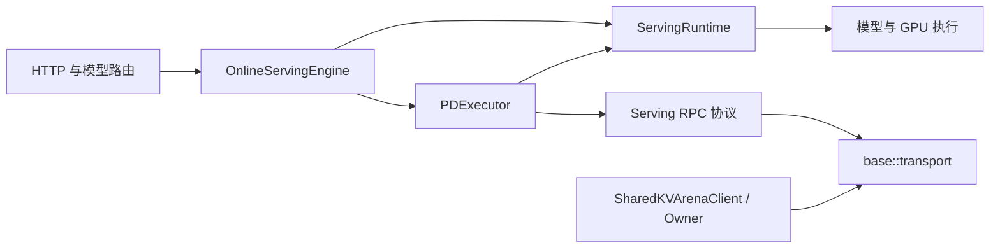

# 服务职责、通信与验证边界重构（2026-10-12）

基于已合入 main 的 `b116371`。本轮按职责分离、状态与可读性、测量优化、验证边界的顺序推进。代码已在本机验证；真实 MPS 和双 GPU NCCL 的运行验收尚未完成。

## 1. 职责与依赖

| 模块 | 责任 | 不应承担的责任 |
| --- | --- | --- |
| `ServingRuntime` | 模型执行、采样、KV 管理器及设备能力接口 | PD 请求编排、远端请求状态 |
| `PDExecutor` | 本地/远端 PD 编排、预填充保留与释放 | 命令行解析、HTTP |
| `BenchConfig` | 组合启动配置 | 直接实现传输与推理 |
| `base::transport` | ZMQ socket 生命周期、JSON 收发、通用二进制编码 | 模型请求、PD manifest 等业务协议 |
| `serving_zmq_rpc` | 请求和 PD 对象的协议转换 | 通用 socket 实现 |
| `SharedKVArenaClient` / Owner / PageGroup | 分别负责映射与租约通信、全局物理容量、模型侧页与 GPU fence | 根据超时擅自复用尚在 GPU 使用的内存 |

`ServingRuntime` 实现从 1,274 行缩减为 30 行；其头文件不再包含服务 RPC 协议，也不持有待释放的远端预填充表。`PDExecutor` 由在线引擎和预填充 Worker 持有，生命周期必须短于 Runtime。同步预填充和批处理预填充使用同一执行互斥锁，避免同时操作模型资源。

共享 KV 的基础代码只依赖 `base/zmq_transport.h`，不再反向包含 `serving/serving_zmq_rpc.h`。服务层暂保留通用传输名字的 `using` 声明，减少无意义的调用点改动。

配置分为 `http`、`pd`、`ipc`、`kv`、`benchmark` 五个子配置。已有命令行参数保持不变；C++ 调用者需改用例如 `config.http.listen_port`、`config.pd.pd_mode`。调度及通用请求配置暂留在组合对象内，未宣称所有配置耦合均已消除。



## 2. 状态和错误处理

请求句柄明确区分 `Open`、`Cancelling`、`Completed`、`Failed`、`Cancelled`。取消后拒绝新增 Token；完成后的结果不会被迟到的完成或取消改写。取消意图不等于 GPU 已停止，最终资源回收仍由执行层负责。

共享页的回收顺序为：最后一个层引用归还 → GPU fence 完成 → 页可在当前租约内复用 → 整个 Chunk 空闲 → Owner 确认 release → 全局容量可被其他模型获取。若 release 回复丢失，无法判断 Owner 是否已经提交释放；PageGroup 会进入失败状态，禁止后续本地分配/归还，而不是继续使用缓存页。

Python 数据客户端展开压缩式代码，以 `Operation` 枚举表达协议操作，以 `DataServiceError.code` 暴露远端错误，保留对 `RuntimeError` 的兼容。短租约描述符作为协议错误处理。ACQUIRE 重试使用相同操作身份；未对其他修改操作添加自动重放。

配置输入错误使用异常并在启动入口统一打印错误、退出；不再对非法调度策略、布尔值、进程角色等输入直接 CHECK 中止。整数尾随垃圾、负无符号数、非有限浮点数均有测试。

## 3. 测量与优化

新增 `zmq_transport_bench`，测量真实本地 IPC 往返。每组 1,000 次，预热 20 次，执行 3 轮并交替前后顺序；下表是各轮分位数的中位数，单位微秒。

| 控制 RPC | 优化前 | 优化后 |
| --- | ---: | ---: |
| P50 | 506.958 | 224.765 |
| P95 | 772.808 | 470.723 |
| P99 | 966.680 | 582.402 |

保留每次控制请求的独立 socket，改为进程内共享 ZMQ context，减少 context 和 I/O 线程反复创建/销毁。socket 的线程归属或外部串行访问约束不变；请求回复丢失后仍不自动重放。进程使用 exec 启动，不能在已初始化通信/CUDA 后 fork 并继承这些对象。

Token 通道继续使用已有的持久 socket、每次最多 32 个事件。上述微基准包含该通道的往返成本，但不是高并发请求调度或完整模型吞吐基准，不据此声称推理加速。

共享 KV 基准增加 P99 和可选 RPC 计时，生产默认不读取计时钟。每桶 300 个样本，每个样本操作 4 个全层页，覆盖两种模型布局与空闲、约 90%、满额情况。空闲时分配 P99 分别约 643 / 422 微秒，归还完成 P99 约 725 / 395 微秒。24 层布局约 90% 占用时可使用现有 Chunk 空页，不发生 Owner RPC，分配 P50 约 3.6 微秒。

`owner_rpc_us` 是分配与释放中、在页管理锁内执行的 Owner 通信总耗时；`rpc_mutex_wait_us` 是客户端通信锁的等待。当前基准单个客户端串行调用，不能由很小的 mutex 等待推断高并发没有竞争。保留同步释放确认及空 Chunk 立即归还，未为了局部命中率扣留其他模型需要的容量，也未引入异步回收。

## 4. 验证结果与未验收项

- 最终 CTest：8 组全部通过。主 C++ 回归 211 通过、11 跳过；独立历史组 43 通过。Python 测试合计 28 通过。
- 历史 `test_*` 测试现在通过 `pbe.legacy` 纳入默认 CTest。Python→C++ TensorBundle 测试夹具由 CTest 自动生成，不再需要手工设置环境变量。
- Qwen2.5-0.5B / 1.5B：输出与独立部署对照一致，取消记录回收、10 次交替请求后 512 MiB 全量归还、Worker 故障停止整个部署均通过。
- drain、cancel、Owner 故障的真实 CUDA IPC 生命周期验证通过。
- MPS：启动环境剔除继承的客户端资源限制，保留外部 daemon 路由；`--check` 明确标记 `check_scope=static` 和 `mps_runtime_verified=false`。已有外部 server 自身的限制仍须由部署方确认。
- MPS 生命周期工具新增 `--backend mps_process --start-mps`。Owner 故障注入要求独立 daemon，避免作用于外部共用服务。
- 本机真实 MPS 探针仍因注册失败退出 1，没有回退；所有本次进程及自建 daemon 均退出。报告保留 `mps_recovery_required=true`，没有把强制停止记为优雅退出。
- NCCL：对 PDExecutor、NCCL handoff、在线引擎和 ZMQ Worker 开启 NCCL 宏进行语法检查，通过。实际回归构建仍是 NCCL OFF，本机仅有一张 GPU，不能认定 NCCL 运行验收通过。
- 其余 11 个跳过项属于多 GPU 路径或缺失的视觉模型测试夹具，未计入通过数。

## 复现入口

```bash
cmake --build build-mps -j4
PBE_QWEN2_TEST_MODEL="$PWD/models/Qwen2.5-0.5B-Instruct/model.bf16.bin" \
PBE_QWEN2_TEST_TOKENIZER="$PWD/models/Qwen2.5-0.5B-Instruct/tokenizer.json" \
ctest --test-dir build-mps --output-on-failure

build-mps/demo/zmq_transport_bench 1000
python3 tools/serving/benchmark_shared_kv.py \
  --output-dir /tmp/pbe-kv-measure-new --iterations 100 --repeats 3
```

目标 MPS 机器需重新编译对应 GPU 架构，配置设备 UUID、模型路径和预算，再运行：

```bash
python3 tools/serving/deploy_multi_model.py --backend mps_process --start-mps --probe
python3 tools/serving/validate_multi_model.py --config configs/qwen25-dual-mps.json \
  --backend mps_process --start-mps --reuse-rounds 5 --output-dir /tmp/pbe-mps-models-new
python3 tools/serving/validate_lifecycle.py --config configs/qwen25-dual-mps.json \
  --backend mps_process --start-mps --scenario drain --output-dir /tmp/pbe-mps-drain-new
```

cancel、owner-failure 分别使用新目录运行；强制故障验证应使用隔离部署。仍须在目标机器验证真实 `terminate_client`、GPU 时间线上的 kernel 并行和资源限制，生命周期通过不能替代这些项目。NCCL 需启用 NCCL 的构建、两张可用 GPU 和模型夹具，运行 `PDHandoffTest.*Nccl*`、`Qwen2DeviceInitTest.*Nccl*`，检查无跳过及输出正确。

完整证据、构建库指纹及限制见 [报告](benchmarks/refactor-architecture-2026-10-12/report.json)。
