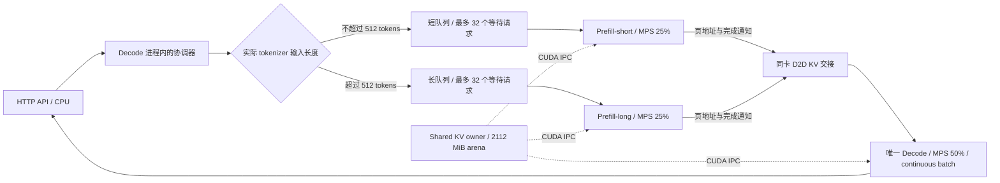

# 单 GPU：Qwen2.5-1.5B 双 Prefill、单 Decode

新增 `split-prefill-ipc` 文本 serving 模式：同一张 GPU 上运行两个独立 Prefill 进程和一个 Decode 进程，三个进程均加载 **Qwen2.5-1.5B-Instruct BF16**。短、长输入分别排队、执行 Prefill，随后合入同一个 Decode continuous batch。

## 请求与 KV 的流向



以 7040-token 输入、8192-token 输出请求为例：

1. HTTP 前端通过 ZMQ 把请求送到 D。D 使用实际 tokenizer token 数分流到长队列；分类包含引擎添加的模板 token，不按字符数猜测。
2. 长队列获得一个长请求槽位和 `ceil((7040 + 8192) / 16) × 16` 个未来 KV token 配额。只有准入成功才派给 P-long；P-short 同时可以接收短队列任务。
3. P-long 分 128-token chunk 执行 Prefill。两个 Prefill 的提交、轮询、释放 RPC 各自运行在异步通道上，D 的计算线程不等待这些网络调用。
4. P 完成 GPU 写入并同步后，返回 owner epoch、handoff ID、页表和首个采样 token，保留源 KV 租约。
5. D 校验 epoch、布局和页范围，从自己映射的同一 arena 中读取 P 的页，复制到 D 所有的页。每个完整 page 包含全部层的 K/V，连续源页和目标页合并成一次 `cudaMemcpyAsync`，避免逐层逐页复制。
6. D 确认复制完成后异步通知 P 释放源页，开始续写自己的 KV。所有请求在一个 D batch 内逐 token 推进，长输出不会回到 Prefill 重算。
7. 请求结束或取消后，D 释放页和未来 token 配额。空 Chunk 归还 owner，其他角色可再次申请这些字节。停机顺序是 HTTP → D → 两个 P → owner；不能在 importer 仍使用显存时提前关闭 owner。

ZMQ 只传请求、token、页表和控制消息。KV 数据留在 GPU；本路径是**共享容量池 + 同卡 D2D 交接**，尚未直接接管 P 的页实现零复制。三个模型进程目前各持有一份权重和私有 workspace；不能把 V4 其他路径的权重共享能力当成本配置已启用的能力。

## 隔离与容量

默认配置：[qwen25-1.5b-2p1d.json](../configs/qwen25-1.5b-2p1d.json)。

| 项目 | 短输入通道 | 长输入通道 |
| --- | ---: | ---: |
| 分流 | ≤512 tokens | >512 tokens |
| 等待队列上限 | 32 | 32 |
| 同时准入请求上限，包含 P 和 D 阶段 | 4 | 2 |
| D 未来 KV token 配额 | 16384 | 32768 |
| P 的共享 KV 硬配额 | 128 MiB | 512 MiB |
| MPS active thread percentage | 25% | 25% |

唯一 D 的共享 KV 硬配额为 1408 MiB，MPS 配置为 50%。共享池共 2112 MiB，包含 Chunk/page 对齐余量。1.5B 的 BF16 KV 为 28672 bytes/token，16-token page 为 448 KiB。每个计算进程私有预算为 6144 MiB；启动器按实际 GPU 空闲显存检查整个部署能否容纳。

输入最多 16384 tokens，输出最多 8192 tokens。最大输入加输出不超过模型上下文。未来 token 配额按每条请求的最大输出预留，而物理 KV 页按实际进度申请；这样避免长输出耗尽另一通道的 Decode 容量。保守预留会降低部分负载的并发度。

这是**按输入长度**分流：短输入、极长输出仍在短通道，并占用短通道自己的配额。同一通道 FIFO 队首可能等待足够的 token 配额；当前没有输出长度预测和同通道抢占。两个通道仍共享 GPU 和 D batch，因此不能承诺所有负载下的短请求延迟。MPS 的百分比是资源上限配置，不是固定 SM 分区或延迟保证。

## 启动与请求

在已编译项目、准备好 PBE BF16 权重和 tokenizer、具备可用 MPS 的 Linux 主机上执行。先把 JSON 中的 `weights`、`tokenizer` 改成该主机实际路径；仓库示例与本次远端验证路径一致。

```bash
cmake --build build-mps --target serving_qwen shared_kv_owner -j8

python3 tools/serving/deploy_split_pd.py \
  --config configs/qwen25-1.5b-2p1d.json \
  --build-dir build-mps --runtime-dir /tmp/pbe-2p1d-check --check

python3 tools/serving/deploy_split_pd.py \
  --config configs/qwen25-1.5b-2p1d.json \
  --build-dir build-mps --runtime-dir /tmp/pbe-2p1d-run
```

每次使用新的 runtime 目录。启动器创建独立 MPS 控制目录，验证 owner、P-short、P-long、D 均注册到同一个 MPS server 后才报告 READY。前台按 Ctrl-C 有序关闭整个部署。任何 worker 或 MPS 注册异常都会停止整个 IPC domain，不尝试继续使用失效的共享指针。

```bash
curl -N http://127.0.0.1:8080/v1/completions \
  -H 'Content-Type: application/json' \
  -d '{"model":"qwen25-1.5b","prompt":"请用一句话介绍中国的首都。","max_tokens":24,"temperature":0,"stream":true}'

curl -s http://127.0.0.1:8080/metrics
```

单模型请求可省略 `model`。`/metrics` 中 `split_pd` 给出两条队列长度、活动请求数、预留 token、完成/取消计数、D batch 峰值、GPU KV 复制字节以及最近请求的实际输入与生成 token 数。`kv_host_copy_bytes=0` 表示这条交接路径不复制 KV 到 Host，不表示请求元数据没有 CPU 通信。

可用 `--backend process` 检查普通多进程功能；它不提供 MPS 注册或跨进程 kernel 同时执行的验收结论。本模式关闭 radix cache，使用 BF16 KV，不依赖 NCCL。

## 复现实机验收

```bash
ctest --test-dir build-mps --output-on-failure

python3 tools/serving/validate_split_pd.py \
  --config configs/qwen25-1.5b-2p1d.json \
  --build-dir build-mps \
  --output-dir /tmp/pbe-2p1d-validation \
  --extreme-output-tokens 8192
```

脚本先运行私有 KV 单进程基线，比较短输入、英文代码和长输入的 greedy 输出，然后启动真实 2P1D：

- 两个长输入约 7040 / 5040 tokens，以及一个短输入约 41 tokens，同时请求固定长度输出；`ignore_eos=true` 用于压力测试，不评价长文本质量。
- 长负载运行时插入三个短请求，检查它们在极长输出结束前完成，并验证实际生成 token 数和多请求 Decode batch。
- 填满长队列，验证过载拒绝和短队列继续服务；取消已提交的长请求。
- 单独让请求进入 Decode、生成至少 16 步后取消，检查已生成 token 数、正常取消状态和全池回收。
- 每轮检查 owner 的 `free_bytes == bytes`、`lease_count == 0`，最后检查整个部署有序关闭。

实测数据及图表见[验收快照](benchmarks/single-gpu-2p1d-2026-10-12/README.md)。其中 HTTP 时间线只说明请求响应先后；两个进程 kernel 同时执行的设备级证据见[独立 MPS 实验](benchmarks/mps-kernel-evidence-2026-10-12/README.md)，不能从 HTTP 时间线推出 SM 利用率。
