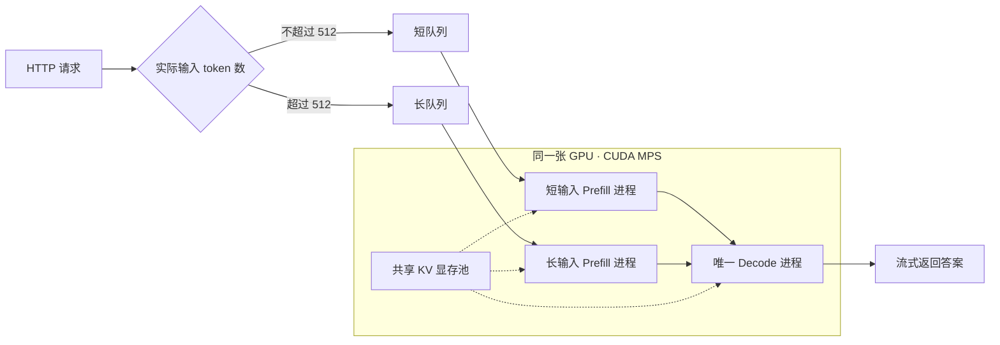
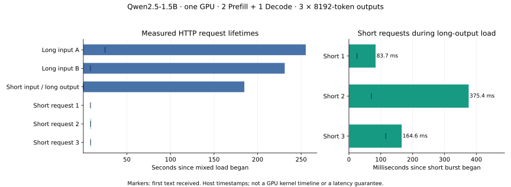
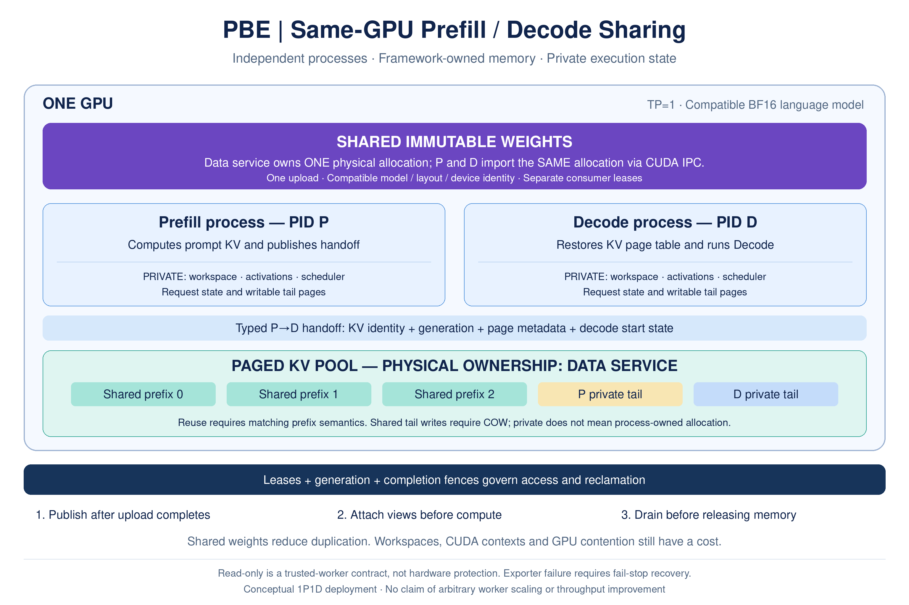
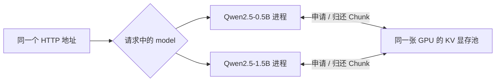

# PagedBatchEngine

**一张 GPU 上，长请求、短请求和不同模型怎样一起跑？**

PagedBatchEngine（PBE）是一个 C++/CUDA 推理引擎。这个项目聚焦在单GPU上的多进程并行，以及多模型共享KV权重，关心的是部署时经常遇到的几个问题：长输入正在计算，后来的短请求能不能先得到回答？把模型拆成几个进程后，KV 怎么交接？两个大小不同的模型，能不能轮流使用同一块显存，而不是各自留下一大片空闲缓存？

目前可以跑三种部署。它们用到的共享机制不同，下面分别说明。

| 想做什么 | 部署方式 | 已有实测 |
| --- | --- | --- |
| 同一个模型同时处理长、短请求 | 单 GPU，两个 Prefill、一个 Decode，长短输入分队列 | Qwen2.5-1.5B，RTX 5090，真实 MPS |
| 把图像处理、读输入、生成答案拆开部署 | 独立 Vision / Prefill / Decode / Data service 进程 | V4 的 Qwen2.5-VL-3B 历史验收 |
| 一台机器同时提供两个模型 | 每个模型一个进程，按模型名路由，共用 KV 显存池 | Qwen2.5-0.5B + 1.5B，RTX 5090，真实 MPS |


[先跑起来](#先跑起来) · [长短请求分队列](#split-pd) · [多角色部署](#把一个请求交给几个独立角色) · [双模型共享显存](#两个模型共用一个-kv-显存池) · [验证记录](#验证到哪一步了)

<a id="split-pd"></a>

## 长短请求分队列：两个 P，共用一个 D

假设一个请求带着几千 token 的会议记录，另一个只问“北京是哪里？”。如果都排在同一条 Prefill 队列里，短问题也可能等前面的长输入算完。

PBE 为这两类输入各安排一个 Prefill 进程。输入经过 tokenizer 后，不超过 512 tokens 的进短队列，其余进长队列。两个 P 算完各自的输入，再把请求交给**同一个 Decode 进程**。D 将已经准备好的请求组成 batch，一起往下生成。



分队列还不够。如果长请求把 Decode 的位置和显存都占满，短队列仍然走不动。所以这里还分开了**同时在途的请求数**和**未来输出所需的 KV 配额**：

| 默认配置 | 短输入通道 | 长输入通道 |
| --- | ---: | ---: |
| 等待队列上限 | 32 个 | 32 个 |
| 同时在途的请求，包含 P 和 D 阶段 | 4 个 | 2 个 |
| Decode KV token 配额 | 16384 | 32768 |

请求在派给 P 之前，会按“输入长度 + 最大输出长度”预留配额；物理 KV 页随计算进度申请。长通道不能花掉短通道的这部分预算。当前分流只看输入长度，**短输入、长输出仍走短通道**，这也是压力测试专门覆盖的一种情况。

P 和 D 通过 ZMQ 传控制消息，用 CUDA IPC 映射同一个 2112 MiB 显存池。P 算完后，D 在 GPU 内把 KV 复制到自己负责续写的页；复制完成才通知 P 归还源页。复制按完整页进行，连续页会合并，避免逐层、逐页发起大量 CUDA 调用。这个版本每个计算进程各有一份 1.5B 权重，KV 交接仍有一次同卡复制。

### 实际跑出来的结果

在 RTX 5090 上同时提交三条请求：输入分别是 **7040、5040、41 tokens**，每条都强制生成 **8192 tokens**。长输出仍在运行时，再插入三个短请求：

| 插入的请求 | 收到首段文本 | 整条请求完成 |
| --- | ---: | ---: |
| 短请求 1 | 25.15 ms | 83.68 ms |
| 短请求 2 | 70.27 ms | 375.37 ms |
| 短请求 3 | 114.60 ms | 164.58 ms |

三条极长输出分别用时约 255、231、185 秒。短请求没有等它们结束；同一个 D 的 batch 峰值是 4。把长队列填满后，33 条长请求被接受（含执行中请求）、5 条被拒绝，短队列仍能完成请求。



测试还分别取消了排队、Prefill 和 Decode 中的请求。每轮结束后，共享池都回到 **2112 MiB 空闲、0 个租约**。这里的租约就是“这段显存还被哪个请求使用”的记录。

这是一轮混合负载的测量，不是延迟保证。三个进程仍争用同一张 GPU；如果短通道自己也排满，后面的短请求一样需要等待。当前这套长短队列部署实际验收的是 **2P1D**，尚不能把它写成任意数量 P 的部署都已验证。

[完整结果与测试条件](docs/benchmarks/single-gpu-2p1d-2026-10-12/README.md) · [机器可读结果](docs/benchmarks/single-gpu-2p1d-2026-10-12/validation.json) · [配置和启动步骤](docs/single-gpu-2p1d-2026-10-12.md)

## 把一个请求交给几个独立角色

这个项目中把多进程按照“干什么活”来拆。以看图问答为例，一条请求会经历下面这些步骤：

1. **Vision** 处理图片，得到视觉特征。
2. **Prefill** 读取文字和视觉特征，算出这段输入的 KV。
3. **Decode** 接着已有 KV 生成答案，避免重新计算整段输入。
4. **Data service** 管理共享数据、页和租约，等所有使用者完成后再回收。

这些角色各有自己的进程，可以分别启动和设置预算。控制消息负责告诉下一个角色“数据在哪里、是否已经准备好”；GPU 数据由对应的共享池或传输路径交接。请求走完以后，不只检查有没有答案，还要检查页和租约是否归还。



V4 的历史验收用真实 Qwen2.5-VL-3B 做了 5 次同卡 P→D 请求：P、D 的 PID 不同，每次交接保留了 95 个输入 tokens，**D 实际重算输入的 token 数为 0**，输出与预热后的统一路径一致。最后 128/128 个 slot 空闲，grant 和 lease 都归零。[交接报告](docs/V4_PERSISTENT_PD_CLOSURE_20260913.md) · [逐项检查 JSON](docs/data_flow_evidence/v4/M9/persistent_pd_deployment_final_gpu0_v4/validation.json)

同一模型的 P/D 还可以共用只读权重。V4 的另一组实验中，Data service 持有一份约 6.17 GB 的权重，两个角色映射同一份 allocation。固定 KV 配额时，设备占用中位数从 16872 MiB 降到 9608 MiB；那组实验的吞吐也下降了约 6.7%，所以这里只把它作为显存节省的证据。[权重共享报告](docs/V4_E4_SHARED_WEIGHT_COMPLETION_20260913.md) · [结果 JSON](docs/data_flow_evidence/v4/E4/checks.json)

**这条 V4 多模态路径与前面的 1.5B 文本 2P1D 是两种部署。** V4 使用 Data service 的共享页和权重；文本 2P1D 使用 Chunk 显存池、私有权重和 D2D 交接。它们的分配器还没有合成一套，最新的 5090 测试也没有重跑全部 V4 多模态实验。

## 两个模型共用一个 KV 显存池

另一种需求是同时提供两个模型：简单请求用 0.5B，复杂请求用 1.5B。PBE 给每个模型一个独立进程，客户端在请求里指定 `model`，HTTP 前端就把请求送给对应的进程。



共享池解决的是显存怎么分。一个 owner 进程先申请一块 GPU 显存，两个模型需要 KV 时，从里面借一段；请求结束、GPU 确认不再使用之后，再归还。以后另一模型可以借走同一段空间。

**两个模型各自算自己的 KV。共享的是存放 KV 的显存容量。** 0.5B 算出的注意力数据不能直接拿给 1.5B 继续推理，但 0.5B 归还的字节区间可以重新组织成 1.5B 需要的 tensor。

它们的 KV 大小确实不同：

| BF16 KV，每页 16 tokens | Qwen2.5-0.5B | Qwen2.5-1.5B |
| --- | ---: | ---: |
| 层数 | 24 | 28 |
| KV heads × head dimension | 2 × 64 | 2 × 128 |
| 单层 K 或 V 的 tensor | `[16, 2, 64]` | `[16, 2, 128]` |
| 全部层 K + V 的一页 | **192 KiB** | **448 KiB** |
| 约 2 MiB 的 Chunk，按整页对齐 | 11 页，2112 KiB | 5 页，2240 KiB |

可以把 Chunk 看成一次借出的连续显存，再由模型按自己的页大小使用。这样 owner 不需要把整个池固定成某一个模型的 tensor 形状。


真实双模型测试记录了 **30 次申请、30 次归还、21 次跨模型复用已释放的字节范围**。例如，0.5B 归还从 offset 0 开始的 2112 KiB 后，1.5B 在 offset 0 申请了 2240 KiB，按自己的 448 KiB 页使用。两个同时存活的租约没有重叠。

两个模型的输出分别与私有 KV 基线一致；10 次交替推理后，每次都恢复 **512 MiB 空闲、0 租约**。这验证了“能使用、能归还、归还后能被另一模型再用”。[双模型结果](docs/benchmarks/mps-kernel-evidence-2026-10-12/models-validation.json) · [分配与归还记录](docs/benchmarks/mps-kernel-evidence-2026-10-12/kv-events.csv)

## MPS 有没有真的让不同进程同时跑？

CUDA MPS 负责让不同进程的 GPU 工作有机会并行执行，CUDA IPC 负责让进程看到共享显存。两者解决的问题不同；启动了几个进程，并不能证明它们的 kernel 正在同时执行。

这里保留两种证据。

**第一种是在诊断 kernel 内部采样。** 两个进程各自执行计算，同时读取 GPU 时钟和 SM 编号。三轮 MPS 测试得到 **28489 / 26892 / 26630** 次相同 GPU 时间戳的跨进程执行采样；关闭 MPS 的三轮对照均为 **0**。本机观测到的时钟粒度是 32 ns，这是该粒度下同时执行设备指令的证据。SM 编号按各自 context 记录，不用它推断固定的物理分区。


**第二种是真实双模型的 Nsight 时间线。** 0.5B 和 1.5B 的记录里有 25381 对跨进程 kernel 区间重叠，重叠区间的并集是 108.840 ms。下图放大其中一段，两个 BF16 GEMV kernel 的区间重叠了 353.151 μs。


时间线展示真实模型在做什么；单看 kernel 起止区间重叠，仍不能排除中途切换，因此另外保留了第一种设备端采样。这里没有据此计算推理加速比，也没有把诊断 kernel 当成模型 kernel。

[采集方法与复现命令](docs/benchmarks/mps-kernel-evidence-2026-10-12/README.md) · [设备采样数据](docs/benchmarks/mps-kernel-evidence-2026-10-12/sm-activity.json) · [Nsight 与 KV 汇总](docs/benchmarks/mps-kernel-evidence-2026-10-12/summary.json)

## 先跑起来

建议先跑 1.5B 的 2P1D，模型和工作负载比较单纯。真实 MPS 验证使用 Linux、RTX 5090、驱动 610.57.04、CUDA 12.8；别的设备先运行预检。普通多进程可用于检查功能，但不能代替 MPS 验证。

```bash
git clone https://github.com/Destination2020/Paged-Batch-Engine.git
cd Paged-Batch-Engine
```

构建需要 C++17、CMake、CUDA，以及 glog、GTest、Armadillo/OpenBLAS、SentencePiece、Abseil、RE2、nlohmann-json、OpenSSL、ZeroMQ。部署脚本还需要 Python 和 pyzmq。依赖准备、模型导出和单进程用法见[文本 serving 使用参考](docs/text-serving-reference.md)；5090 上的具体编译配置见[环境记录](docs/cuda-mps-v4-integration-2026-10-11.md#2026-10-12-原生-linux--rtx-5090-验收补充)。

```bash
cmake -S . -B build-mps -DCMAKE_BUILD_TYPE=Release \
  -DQWEN2_SUPPORT=ON -DKUIPER_ENABLE_ZMQ=ON -DKUIPER_ENABLE_NCCL=OFF
cmake --build build-mps -j8
ctest --test-dir build-mps --output-on-failure
```

下载 Qwen2.5-1.5B-Instruct，并用 `tools/export_qwen2.py --dtype=bf16` 导出 PBE 格式权重。把 [2P1D 配置](configs/qwen25-1.5b-2p1d.json) 中的 `weights` 和 `tokenizer` 改成实际文件路径，然后执行：

```bash
python3 tools/serving/deploy_split_pd.py \
  --config configs/qwen25-1.5b-2p1d.json \
  --build-dir build-mps --runtime-dir /tmp/pbe-2p1d-check --check

python3 tools/serving/deploy_split_pd.py \
  --config configs/qwen25-1.5b-2p1d.json \
  --build-dir build-mps --runtime-dir /tmp/pbe-2p1d-run
```

每次启动使用一个新的 runtime 目录。看到 `READY` 后，可以发请求；前台按 Ctrl-C 会按依赖顺序关闭整个部署。

```bash
curl -N http://127.0.0.1:8080/v1/completions \
  -H 'Content-Type: application/json' \
  -d '{"model":"qwen25-1.5b","prompt":"请用一句话介绍中国的首都。","max_tokens":24,"temperature":0,"stream":true}'
```

要跑双模型，复制 [5090 实测配置](docs/benchmarks/rtx5090-mps-2026-10-12/deployment-config.json)，修改两个模型的文件路径，再交给另一个启动器。两种服务默认都用 8080 端口，请分别运行。

```bash
python3 tools/serving/deploy_multi_model.py \
  --config /path/to/your-dual-model-config.json \
  --build-dir build-mps --backend mps_process --start-mps
```

此时把请求中的 `model` 改成 `qwen25-0.5b` 或 `qwen25-1.5b`，就会选中对应的模型进程。V4 多模态角色的启动和重放入口在[常驻 P/D 报告](docs/V4_PERSISTENT_PD_CLOSURE_20260913.md)与[共享权重报告](docs/V4_E4_SHARED_WEIGHT_COMPLETION_20260913.md)中。

## 验证到哪一步了

最新 2P1D 的默认 CTest **10/10 组通过**；其中包括历史测试、共享 KV 复用、HTTP、配置和准入隔离。真实模型、真实 MPS 和长输出用独立脚本验收，记录分别保留。

| 要查看的内容 | 证据入口 |
| --- | --- |
| 2P1D 长短请求、8192-token 输出、取消、全池回收 | [报告](docs/benchmarks/single-gpu-2p1d-2026-10-12/README.md) / [JSON](docs/benchmarks/single-gpu-2p1d-2026-10-12/validation.json) |
| 三个计算进程注册 MPS、正常退出 | [注册记录](docs/benchmarks/single-gpu-2p1d-2026-10-12/rpc-validation.json) / [退出记录](docs/benchmarks/single-gpu-2p1d-2026-10-12/shutdown.json) |
| CTest 各组结果 | [verification.json](docs/benchmarks/single-gpu-2p1d-2026-10-12/verification.json) |
| 双模型 kernel 并行与不同 KV 布局复用 | [报告与图表](docs/benchmarks/mps-kernel-evidence-2026-10-12/README.md) |
| V4 多角色、共享权重、失败与恢复边界 | [V4 架构](docs/PBE_MULTI_ROLE_MULTIMODAL_ARCHITECTURE_V4_20260912.md) / [权重验收](docs/V4_E4_SHARED_WEIGHT_COMPLETION_20260913.md) |

最新 5090 构建关闭了 NCCL，没有验证双 GPU NCCL。多模型 Chunk 池与 V4 Data service 也还不是同一个分配器。PBE 目前适合研究部署、调度和显存生命周期；需要生产级可用性或稳定延迟时，还得针对实际硬件与负载继续测试。

仓库保留小型 JSON、CSV、SVG 和验收文档。大型 Nsight 文件、完整采集数据和模型权重不随代码发布；文件范围和哈希见[证据说明](docs/EVIDENCE_PUBLICATION.md)。图表中的数值都能对应到结果文件。

## 从哪里读代码

| 内容 | 入口 |
| --- | --- |
| 2P1D 编排与长短通道准入 | [split_pd_engine.cpp](infMain/source/serving/split_pd_engine.cpp)、[split_pd_admission.h](infMain/include/serving/split_pd_admission.h) |
| 请求入口、ZMQ、HTTP 和模型路由 | [serving](infMain/source/serving/) |
| Chunk KV 池与 owner/client | [shared_kv_arena.cpp](infMain/source/base/shared_kv_arena.cpp)、[shared_kv_client.cpp](infMain/source/base/shared_kv_client.cpp)、[shared_kv_owner.cpp](demo/shared_kv_owner.cpp) |
| V4 数据服务、共享资源与租约 | [data](infMain/source/data/) |
| 部署与真实模型验收脚本 | [tools/serving](tools/serving/) |
| CPU/CUDA 算子与模型 | [op](infMain/source/op/)、[model](infMain/source/model/) |

## 代码来源与许可证

早期工程沿用了 [KuiperLLama](https://github.com/zjhellofss/KuiperLLama) 系列的推理代码和项目结构。PBE 在此基础上继续实现分页 KV、在线调度、多角色部署和共享资源管理；仓库中的第三方文件保留各自的版权与许可声明。

当前仓库公开可见，但尚未声明覆盖整个项目的开源许可证。基础代码的授权范围确认后，再补齐项目许可证；暂时不要把“可以浏览源码”理解成已经获得任意再分发或商用授权。模型权重另按各自模型许可证使用。

欢迎用 [Issues](https://github.com/Destination2020/Paged-Batch-Engine/issues) 记录复现结果和问题。最好附上 GPU、驱动/CUDA 版本、模型、启动配置和最小请求，便于判断是部署环境、调度还是计算路径的问题。
