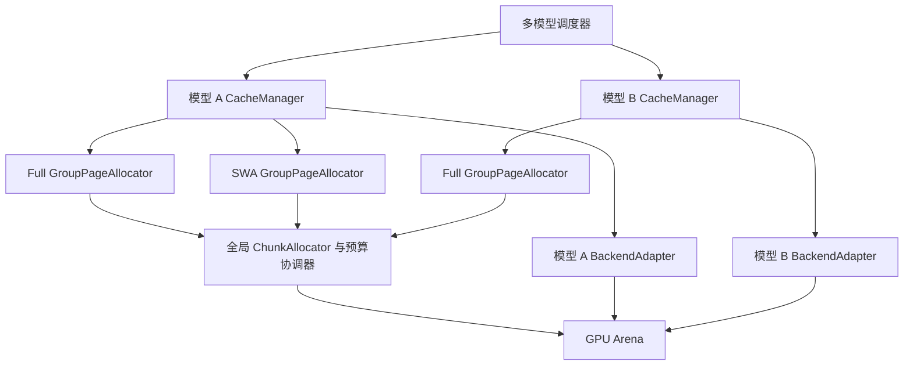

本方案面向在一张 GPU 上同时加载多个模型、动态复用 KV 显存容量的推理系统。推荐采用一个全局字节 Arena、按模型和缓存组组织的局部 PageAllocator，以及统一的预算与回收协调器。模型之间复用已释放的物理空间；各模型的 KV 内容、布局、请求映射和保留规则保持独立。

版本：V1 草案。日期：2026 年 10 月 3 日。本文描述拟实现架构，尚未完成编码、GPU 验证或性能测量。首版默认单 GPU、单进程、多个模型实例，模型权重同时驻留，不同模型的 forward 交替执行。后续再扩展多 stream 并发与多进程 worker。

**第一版要交付什么。**

第一版支持两个使用不同 KV 几何参数的 MHA/GQA 模型，统一使用 BF16 和一个经验证的 paged attention 后端。一个模型释放缓存后，另一个模型可以获得其归还的 chunk，且模型输出与独立运行基线保持一致。

容量按实际 GPU 预算配置，不预设显卡型号或固定并发数。权重、执行工作区和 KV 分开预算；所有常驻权重必须先满足部署容量约束。共享 KV 池不减少模型权重大小，也不承诺同时运行的全部请求都能装入显存。

Full/SWA、MLA/DSA 与递推状态在接口中预留，分别作为后续接入阶段。V1 不移动活跃 KV，不进行跨模型 KV 内容去重，不实现请求卸载、跨 GPU 或多进程共享。

**系统由全局空间管理和模型缓存管理共同组成。**



| 模块 | 所有权及职责 |
| - | - |
| GpuArena | 持有底层 GPU allocation；管理基地址、总字节数、尾部保护区和销毁 |
| GlobalChunkAllocator | 唯一的字节区间所有者；分配、归还、合并空闲区间，维护租约代次 |
| BudgetCoordinator | 请求接纳、模型配额、完整分配计划预留、压力回收 |
| ModelCacheManager | 请求到逻辑 block 的映射，缓存组生命周期，前缀引用和分配计划 |
| GroupPageAllocator | 在本组租入的 chunk 内分配固定布局的 pages；空 chunk 归还全局 |
| BackendAdapter | 将布局及地址映射转换成具体 attention kernel 的 tensor 和元数据 |
| DeferredReclaimer | 等待最后一次 GPU 使用完成，再允许 page 或 chunk 被复用 |

这些是职责划分，V1 可以在同一进程内实现为对象和模块，无需分别创建线程或服务。全局元数据在一个调度控制线程中串行修改。

**Chunk 是字节空间租约，Page 是模型语义中的缓存分配单位。**

Arena 是启动时申请的共享大块显存。Chunk 是从 Arena 划出的连续字节区间，一次只授予一个模型实例的一个缓存组。Page 是组内为若干 token 保存该组全部层数据的单位。一个 chunk 容纳多个同布局 page，也允许大 page 独占一个 chunk。

逻辑 block 标识请求中的 token 范围，其长度由该组的 tokens_per_block 决定。逻辑 block ID 与物理 page 位置解耦。StateSlot 则用于递推状态或检查点，不强行解释成若干 token 的 KV。

相同组内，各层共享页分配结果，但保存独立内容。不同组可以有不同层数、head 数、维度、组件与保留规则。

| 类型 | 示例保留规则 | 分配单位 |
| - | - | - |
| Full MHA 或 GQA | 保留请求所需历史及被引用的前缀 | token block |
| SWA | 按窗口、页边界和有效引用释放旧历史 | token block |
| MLA | 保存压缩 latent 及位置相关 key | token block |
| DSA | 主 KV 与索引组件关联管理；稀疏读取不自动允许删除历史 | token block 或关联组件集合 |
| 递推层 | 保留当前请求状态，按策略保留检查点 | state slot |

分组必须同时考虑布局与回收规则。窗口为 1024 与 4096 的层默认分组；若选择合组，则按较大窗口保留并明确计入额外成本。

**模型注册时声明布局，物理 Arena 不携带某一个模型的固定形状。**

建议的数据契约如下，字段表示设计语义，不是已经实现的 API：

```text
ModelCacheSpec
  model_instance_id
  cache_compatibility_id
  groups[]
    group_id
    layer_ids
    storage_kind
    allocation_unit
    tokens_per_block
    components[]
      name, dtype, shape, strides, alignment
    layout_id
    retention_policy
    backend_adapter_id

ChunkLease
  arena_id, chunk_id, generation
  model_instance_id, group_id, layout_id
  byte_offset, byte_length

PageHandle
  model_instance_id, group_id, logical_block_id
  chunk_id, generation, page_index, page_generation

RequestCacheState
  request_id
  block_tables_by_group
  valid_tokens, committed_tokens
  state_slots
```

cache_compatibility_id 用于约束前缀复用，包含权重版本、适配器、位置编码及影响 KV 计算和表示的配置。V1 只在同一模型实例中复用兼容前缀，默认关闭前缀缓存以简化首轮验证。模型的显示名称不能充当完整身份。

generation 在 chunk 租约重新授予时变化；page_generation 在同一 chunk 内的 page 被重新分配时变化。释放和映射更新同时校验这两个代次，用于拒绝取消、延迟释放等路径中的过期句柄。这些代次不能替代 GPU 同步；旧 kernel 必须完成后才能复用对应空间。

**首版采用可对齐的空闲区间分配器，chunk 大小由目标值与布局共同决定。**

对于普通 MHA/GQA，组内全部层每个 token 的字节数为：

```text
E_g = L_g × Hkv_g × (Dk_g + Dv_g) × element_bytes
B_g = tokens_per_block_g × E_g
```

E_g 覆盖本地缓存组全部层，B_g 是这个组一个物理 page 的大小。复杂布局由 BackendAdapter 给出实际 B_g，包含量化 scale、组件 padding 等开销。

Chunk 不是必须等长的 slab。设目标大小为 C_target，组级对齐单位为 A_g，则采用：

```text
C_g = round_up(max(C_target, B_g), A_g)
```

对 V1 的 page-major GQA adapter，A_g 必须同时满足后端对齐要求和 B_g 的整数倍约束；chunk 相对 Arena 基址的偏移也按 A_g 对齐。建议以 2 MiB 作为首轮实验目标值，再与其他大小比较；这是待测参数，不是固定结论。B_g 大于目标值时，一个 chunk 可只装一个 page。

全局分配器维护按地址排序的空闲区间以及可按大小查找的索引。选择能满足长度和对齐的区间，切分前缀空闲、租约区间与后缀空闲；归还时合并相邻空闲区间。V1 使用简单的对齐 best-fit 策略，可先实现线性查找以验证正确性，再根据 profiling 优化索引。

不把首版绑定为二次幂 buddy allocator：组级页大小可能不是二次幂，强行适配会引入额外 padding。即使总空闲字节足够，也可能因为没有满足对齐的连续区间而分配失败；应明确返回碎片原因。V1 可尝试缩小为一个 page 的 chunk，但不移动活跃数据。

**组内采用先填满再扩张的策略，并及时归还空 chunk。**

GroupPageAllocator 维护每个 chunk 的 free page bitmap、已预留页数、有效页数、等待 GPU 完成的页数和引用信息。分配优先填充已有部分使用的 chunk，再申请新 chunk，以提高整个 chunk 变空的概率。V1 直接把空 chunk 归还全局，暂不设置每模型的空 chunk 常驻配额。

Page 的状态转换为：

```text
FREE → RESERVED → IN_USE → RETIRED → FREE
```

RESERVED 表示尚未提交的事务预留，不能被其他请求分配。IN_USE 包括仍被请求或前缀缓存引用的数据。RETIRED 表示逻辑引用已结束，但 GPU 仍可能使用。只有 GPU fence 完成后才能重新进入 FREE。

Chunk 在全部 page 均为 FREE、没有事务预留、没有 GPU 使用且没有有效租约外部引用后归还全局。释放 page 不等于归还 chunk：部分使用 chunk 内的空 page 只能被同组复用，不能直接计入其他模型可用的全局空间。

V1 不清零整个 chunk 作为固定步骤。适配器必须保证读取仅访问已经写入且有效的位置；padding、量化元数据和需要初始化的区域由适配器明确初始化，并在测试中检查越界和未初始化读取。

**逻辑映射保持独立，后端适配必须证明每个地址合法。**

地址链路为：

```text
(request_id, group_id, token_position)
  → logical_block_id + in_block_offset
  → PageHandle
  → Arena 基址 + chunk 偏移 + page 偏移 + 组件及层内偏移
```

V1 的 page-major GQA page 把组内每层的 K、V 连续排列：

```text
page = [layer0_K × P][layer0_V × P]
       [layer1_K × P][layer1_V × P] ...
```

适配器可以参考本地 SGLang 的 per-layer Arena views 与 kernel-facing ID 转换。若页大小为 B_g，chunk 偏移为 O，page_index 为 j，则 O 必须是 B_g 的整数倍，物理组页索引为 O / B_g + j。再由适配器把它转换为 kernel 期望的 block ID 或索引。直接把 chunk_id 当成现有 kernel 的 block ID 是错误的。

不同布局的 tensor view 可以覆盖同一个 Arena 地址范围；运行期有效分配的字节区间必须互不重叠。view 能看到的地址范围不代表组拥有全部对应存储。dtype 对齐、可访问边界和 per-layer view 的尾部保护区必须在初始化时校验并计入预算。

首版限定同组 K/V 行宽相同的 GQA 布局。后端不接受相应索引转换、stride 或稳定指针契约时，注册失败并报告不支持，不能静默改成另一种布局。MLA、DSA 和非对称 K/V 需要单独 adapter。

CUDA Graph 先关闭；接入后必须固定图中 tensor 的地址及元数据容量，在 replay 前更新合法映射，并在 graph bucket 越界时走非图路径或重新捕获。V1 的 Arena 不在线搬迁或扩容。

**分配以整个 batch 的资源计划提交，GPU 使用通过 fence 结束。**

一次 prefill 或 decode 的建议流程：

1. ModelCacheManager 根据每组尾页剩余空间、窗口、共享前缀、推测状态及计划处理的 token 数，生成 AllocationPlan。

2. BudgetCoordinator 同时计算组内可复用 page 和需要向全局申请的完整 chunk 字节数。配额按实际租入 chunk 的字节数收费，不能只按有效 token 载荷收费。

3. 控制线程执行 prepare，预留所有组需要的 page、chunk 和元数据。V1 采用串行事务；任一资源不足就回滚全部预留。prepare 阶段不启动 GPU 工作。

4. BackendAdapter 校验并准备写入位置、读取 block table 和有效长度；commit 后发布新映射。模型完成当前 forward 的必要写入后，才把对应数据标为可复用前缀。

5. 执行器提交 GPU 工作并记录完成事件。取消请求只能撤销逻辑需求，不能立即覆盖已经提交给 GPU 的页。

6. DeferredReclaimer 在相关完成事件满足后释放 RETIRED pages，并归还变空 chunk。

同一 page 被多个 stream 使用时，释放必须等待所有相关使用结束；可以记录多个事件或用一条汇合 stream 生成 fence。首版不同模型 forward 串行执行，仍保留 fence 契约，避免将来并发时重写接口。

建议的概念接口：

```text
register_model(spec) → ModelHandle
prepare_allocation(model, plan) → Reservation
commit(reservation) → HandlesAndMappings
abort(reservation)
retire(handles, completion_fence)
collect_completed() → returned_chunks
trim_idle(model) → returned_bytes
snapshot_usage() → Accounting
```

接口支持幂等的事务和释放请求标识；重复释放不得把同一空间再次加入 free list。GPU 执行失败后不能回滚为可立即复用的普通空闲页，应隔离相关租约；设备级错误进入 worker 重启与整池重建路径。

**容量由全局预算和模型配额约束，热路径不调用 CUDA malloc。**

初始化预算从实际驻留权重和执行需求得到：

```text
KV_budget = GPU_available_after_weights
            - execution_reserve
            - graph_and_metadata_reserve
            - safety_margin
```

如果测量发生在这些资源已分配之后，必须避免再次扣除相同预留。Arena 的 padding、guard 区、设备映射表也要入账。多个模型初始化应由一个协调器完成，禁止各自独立按 mem_fraction_static 预留一大块缓存。

每个模型配置软份额、硬上限和调度权重。软份额用于争用时的公平调度，空闲时允许借用；硬上限约束该模型实际租入的 chunk 总字节数，包括 RESERVED 和 RETIRED 资源。硬上限之和可以大于总池，但每次实际分配仍必须满足全局预算。

首版不承诺可以随时兑现的硬最低保障。若需要硬保障，必须在接纳其他请求前预留相应全局余量，不能先借给不可抢占的活跃请求，再要求立即归还。

跨模型切换时，为公平性按 batch 或 token budget 轮转执行。长 prefill 使用分块调度；模型的容量竞争与 GPU 执行时间竞争分别计量。

**压力回收优先处理真正可回收的空间，避免虚假的容量承诺。**

申请失败后，按以下顺序处理：

1. collect_completed，回收已经完成 GPU 使用的 RETIRED pages。

2. 归还全局可释放的空 chunk，并合并空闲区间。

3. 启用前缀缓存的版本中，淘汰未锁定的兼容前缀缓存；重新判断是否有整个 chunk 变空。

4. 如果大 chunk 因外部碎片失败，尝试合规的较小 chunk。

5. 降低当前计划的 prefill chunk 大小，或延后接纳新请求。

6. 仍不足则返回明确的容量不足结果。后续版本才考虑请求抢占、卸载与活跃页整理。

BudgetCoordinator 要维护当前活跃请求到下一次确定释放机会所需的可行性，不能只让所有请求恰好完成 prefill、却不给 decode 增长留空间。V1 对每个请求采用输出上限约束，并使用保守的最坏缓存增量接纳检查。检查覆盖 chunk 取整、组级对齐、硬配额与实际区间布局；需要确定完成保障时，在接纳阶段预留可实现的 chunk 区间，随后再按 batch 分配其中的 pages。仅预留字节额度不能保证未来不受碎片阻碍。已存在的可复用页和空闲区间不能重复计入承诺；提前预留区间会降低可借用容量，需要与延迟申请策略分别测量。

释放 cached page 不一定降低模型的 leased_bytes；只有它推动整个 chunk 归还时，才真正增加跨模型可用空间。

**用一个字节示例检查跨模型复用是否成立。**

以下为分配器教学例子，不是实测结果；页大小已经包含组内全部层的 K/V。总 Arena 为 12 MiB，目标 chunk 为 2 MiB。模型 A 的 page 为 512 KiB，所以每 chunk 放 4 页；模型 B 的 page 为 1 MiB，所以每 chunk 放 2 页。忽略保护区和元数据。

| 阶段 | A 租入 | B 租入 | 全局空闲 | 结果 |
| - | - | - | - | - |
| 初始负载 | 6 MiB | 4 MiB | 2 MiB | A 持有 3 个 chunk，B 持有 2 个 |
| A 释放 4 页但分散在仍非空的 chunk 内 | 6 MiB | 4 MiB | 2 MiB | A 局部多出 2 MiB 可用页；B 不能直接使用 |
| A 的一个 chunk 最终全部空闲并归还 | 4 MiB | 4 MiB | 4 MiB | 跨模型可用空间真正增加 |
| B 扩张并取得 2 个 chunk | 4 MiB | 8 MiB | 0 | A 归还的容量已被 B 使用 |

页引用和 GPU fence 完成是表中释放成立的前提。实验必须同时记录本地空闲页和全局空闲字节，避免把第一种释放误报成跨模型共享收益。

**必须持续校验所有权和显存账目。**

核心正确性约束：

- 不同活跃 ChunkLease 的字节区间互不重叠；区间始终位于 Arena 可用范围内且满足布局对齐。

- 每个已租入 chunk 的全部 page 都恰好属于一种状态；引用共享不重复计算物理页。

- RESERVED 或 RETIRED 页不能分配给其他请求；归还的 chunk 没有未结束的 GPU 使用。

- block table 的模型、组、layout_id 和 generation 与租约一致。

- 已提交映射不引用已归还 chunk；prepare 失败后不遗留预算、句柄或元数据。

- 对同一模型的缓存复用必须满足兼容性；跨模型默认不共享内容。

同一时刻的账目采用互斥分类：

```text
Arena_bytes = global_free_bytes
              + leased_chunk_bytes
              + arena_guard_bytes

leased_chunk_bytes = referenced_page_capacity
                     + reserved_page_capacity
                     + retired_page_capacity
                     + local_free_page_capacity
                     + chunk_padding_bytes
```

有效 token 载荷另行统计，它小于或等于 referenced_page_capacity，二者差额包含尾页未填满等开销。所有统计必须读取一致的控制线程快照。

观测项包括每模型及每组 leased_bytes、有效载荷、局部空闲、等待 fence 的字节、cached-only 字节、chunk 归还次数、最大可分配连续区间、分配失败原因，以及 prepare/commit 延迟。未来增加并发后另记事件等待时间和各模型执行占比。

**从现有项目复用机制，但替换全局容量归属方式。**

本次设计参考本地 SGLang 提交 0bcd822 与 PBE 提交 40afd32；这两个提交标识不能覆盖未提交的工作区修改。下面是源码观察与拟议改造的对应关系。

| 本地机制 | 在本方案中的用途 |
| - | - |
| UnifiedKVPool 的 SubPoolSpec 和 per-layer views | 参考缓存布局声明、Arena 视图及地址转换；新全局层改为 chunk 租约 |
| MultiEndedAllocator 的虚拟到物理映射及 fence 处理 | 参考句柄与物理位置解耦；V1 不沿用多端增长和活跃页压缩策略 |
| SWAKVPool 和窗口释放逻辑 | 参考 group 路由、独立生命周期及前缀恢复条件 |
| PBE 外部池绑定与 CUDA IPC | 为后续多个 worker 连接同一物理 owner 提供基础 |

[本地 UnifiedKVPool](D:/Items/sglangNew/python/sglang/srt/mem_cache/unified_memory_pool.py:293)、[本地页布局](D:/Items/sglangNew/python/sglang/srt/mem_cache/layout/page_major.py:41)、[本地分配器](D:/Items/sglangNew/python/sglang/srt/mem_cache/multi_ended_allocator.py:3046)、[PBE IPC 描述](D:/Items/Paged-Batch-Engine/infMain/include/data/ipc_pool.h:14)、[PBE 外部池绑定](D:/Items/Paged-Batch-Engine/infMain/include/base/block_allocator.h:56)。

建议新增的模块职责为 arena、chunk_allocator、model_registry、group_page_allocator、budget_coordinator、deferred_reclaimer、backend_adapters 和 accounting。具体源码目录在选定主集成仓库后确定，避免同时改动两套引擎。

PBE 现有描述包含固定的层数、head 数和维度。多模型版本需要把物理内存描述与模型布局描述分开，不能直接让所有模型套用同一个 KVPoolDescriptor。

**实现分四个阶段，每阶段通过后再扩大支持面。**

| 阶段 | 实现范围 | 验收条件 |
| - | - | - |
| A | CPU 上的区间分配、对齐、chunk/page 状态机和事务模拟 | 随机分配释放、重复释放、过期 generation、碎片失败和回滚均保持账目守恒 |
| B | 单 GPU 两个 BF16 GQA 模型，交替 forward，一个验证过的后端 | 与独立运行比较 logits 误差和固定配置下生成结果；A 归还的实际区间能被 B 正确复用 |
| C | 同模型前缀共享与 Full/SWA 分组 | 窗口释放、取消、前缀锁定、尾页共享及必要的写时复制均正确；完整 allocation plan 不留半完成状态 |
| D | MLA/DSA、递推状态、多 stream 和 CUDA Graph 分别接入 | 每个能力独立通过布局、生命周期、输出、同步和压力测试后声明支持 |

阶段 B 需要覆盖长短请求混合、page 边界、chunk 边界、A/B 高频切换、请求取消、prepare 失败、尾页写入以及 GPU 延迟完成。使用已验证的独立池路径作为正确性和性能基线，不能只检查程序不崩溃。

性能实验保持模型、输入、总缓存预算和执行调度一致，比较静态独立池与共享 chunk 池。至少包含负载集中在单模型、两个模型交替峰值、同时持续高负载，以及专门制造部分空闲 chunk 的碎片负载。记录峰值显存、可服务负载、吞吐、TTFT、TPOT、分配延迟与碎片；不预设收益比例。

阶段 D 中各项相互独立，不一次性叠加修改。尤其不能用稀疏 attention 的读取数量估算 DSA 的历史存储需求。

**后续多个 worker 仍共享一个物理 owner，局部分配保持在 worker 内。**

```text
Worker A：ModelCacheManager + GroupPageAllocator
Worker B：ModelCacheManager + GroupPageAllocator
                     ↓ 批量申请及归还 ChunkLease
              每 GPU 一个 MemoryOwner
                     ↓
                  GPU Arena
```

worker 通过 IPC 导入 Arena，在获得的租约范围内分配 pages。owner 负责全局区间与租约，worker 负责模型语义。热路径在已有 chunk 内分配 page，不逐 token 发送 RPC。worker 归还 chunk 时提交可验证的完成信息，owner 在确认 GPU 不再使用后才转授。

多进程版本必须补充 owner/worker incarnation、租约恢复、超时与进程退出处理。心跳超时不能直接证明 GPU 已停止读写。各进程映射的虚拟基地址可能不同，跨进程传递字节偏移和句柄，不传递可直接使用的裸指针。

保留未来的 ArenaBackend 接口，以接入 CUDA VMM 或其他存储实现；V1 不依赖 VMM，也不把 CUDA Unified Memory 当成这里的共享 KV 容量机制。

**实施前剩余的输入只影响容量和适配选择，不改变上述所有权结构。**

需要在进入编码时确定 GPU 型号与显存、首批两个模型、主集成仓库、选定 attention 后端、最大输入输出长度以及并发目标。在这些信息尚未确定时，以本方案的单进程串行 forward、BF16 GQA 和可配置 chunk 目标大小作为默认实现边界。

首个里程碑是：让两个模型在同一个 Arena 中使用不同 KV 布局，完成可追踪的 chunk 转授，并证明输出正确、无提前复用、无泄漏。只有这个闭环成立，再引入更复杂的缓存类型与 worker 拓扑。
